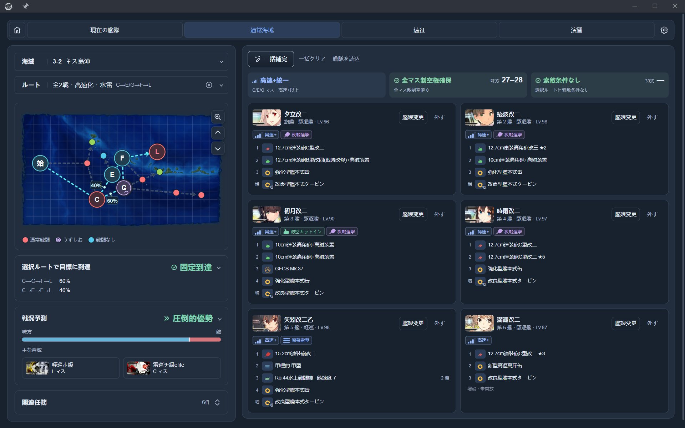
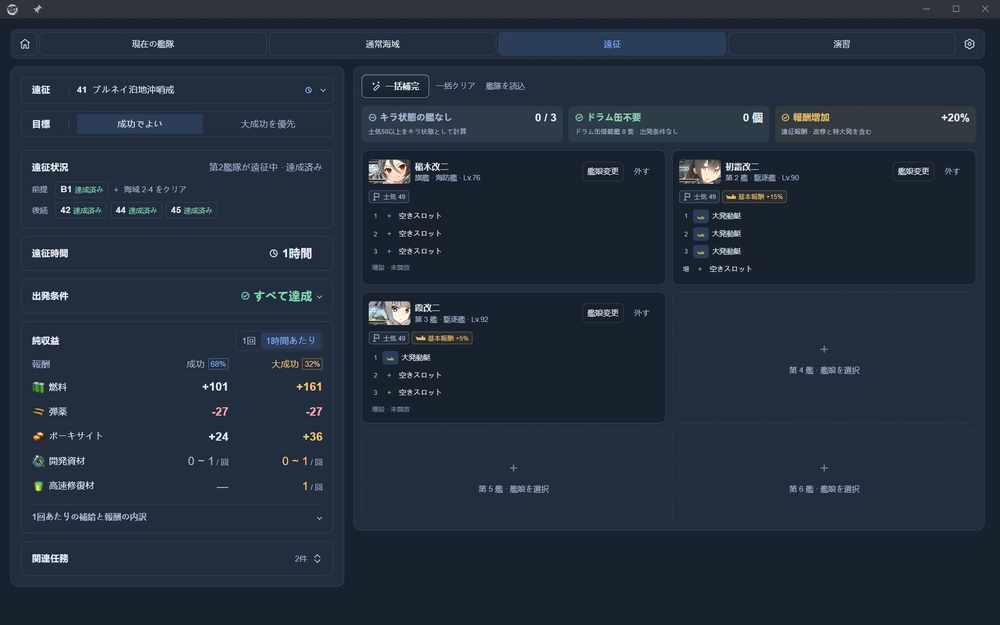
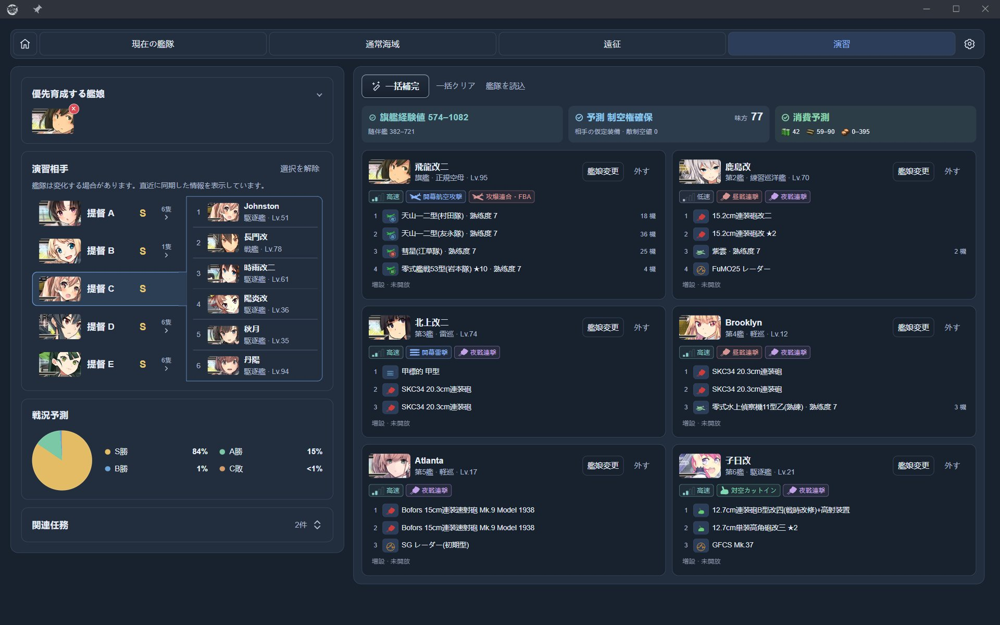

# 艦隊参謀 / Fleet Advisor

[简体中文](README.md) | [繁體中文](README.zh-TW.md) | 日本語

『提督、艦隊の編成と装備は、私にお任せください。』

艦隊参謀は、poi 向けの艦隊編成・装備プラグインです。手持ちの艦娘と装備から出撃・遠征・演習の編成を提案し、ルート、制空、索敵、遠征の収支を確認できます。

## できること

| 画面 | 機能 |
| --- | --- |
| 現在の艦隊 | 艦隊、装備、戦闘の仕組み、任務の進捗を確認 |
| 通常海域 | ルートと敵情報を確認し、編成・装備を提案。ルート条件、制空、索敵を確認 |
| 遠征 | 条件を満たす編成を提案し、大成功率と補給費を差し引いた収支を確認 |
| 演習 | 相手艦隊を確認し、戦闘力と育成を両立する編成を提案。戦況、経験値、消費の参考値を表示 |

## 画面プレビュー

スクリーンショットは日本語の画面です。演習相手の提督名はサンプルに置き換えています。

遠征・演習画面を見る

## インストールと使い方

1. poi のプラグイン管理から `poi-plugin-fleet-advisor` をインストールして有効にし、ゲームデータの読み込み後に「艦隊参謀」を開きます。
2. 海域・遠征・演習相手を選び、必要に応じて艦娘と任務を指定します。
3. 「一括補完」で編成案を生成し、必要に応じて艦娘、装備、並び順を調整します。
4. ルート条件、遠征の出発条件、画面上の注意を確認してから使用します。

インストール済みの場合は poi から更新できます。[npm ページ](https://www.npmjs.com/package/poi-plugin-fleet-advisor)も参照してください。

## 設定と補足

- **言語と絞り込み**：簡体字中国語、繁体字中国語、日本語に対応。初回起動時は poi の言語設定を優先し、その後は設定画面から言語や艦娘の絞り込みを変更できます。
- **装備の借用**：艦隊に所属していない艦娘と所属中の艦娘からの借用を、それぞれ設定できます。遠征中の艦娘からの借用と基地航空隊の装備の使用には対応していません。手動で保持した装備は提案時にも保持されます。
- **基地航空隊**：6-4、6-5、7-4 では航空機、行動、攻撃目標を計画できます。転換や補給には時間や資源が必要になる場合があります。
- **ゲームデータ**：ログイン後、任務、海域進捗、基地航空隊、ゲーム内の編成記録、遠征状態をバックグラウンドで同期します。演習相手は演習画面を開いたときに同期します。ゲームデータキャッシュを消去すると、ローカルの任務進捗記録も削除されます。
- **AI ツール**：設定画面で MCP を有効にし、表示されたアドレスを同じパソコン上の AI ツールに入力します。既定のアドレスは `http://127.0.0.1:47615/mcp` で、読み取り専用の照会、評価、提案に対応しています。詳しくは [MCP API](docs/MCP_API.md) を参照してください。

## 使用上の注意

- 提案は最適解を保証するものではありません。「要確認」は資料不足を示します。画面上の注意を確認してください。
- 到達率に戦闘による撤退は含まれません。制空損耗、演習の戦況、遠征の大成功率、戦闘を伴う遠征の修理費用は推定値です。演習相手の装備は仮定しています。
- 過去の任務進捗はゲーム内の状態を基準としてください。ゲーム内の固有名はそのまま表示し、一部の動的なルールや診断文は原文のまま表示される場合があります。

**自動操作は初期設定で無効**です。設定の「実験機能」で有効にすると、ゲーム画面のクリックを模擬して編成案を適用できます。この機能は開発・テスト用です。自動操作はゲームの規約に違反し、アカウントにリスクを及ぼす可能性があります。無効にしても照会、提案、プレビュー、編成案の編集は利用できます。

## ドキュメントとフィードバック

- [設計と保守](docs/ARCHITECTURE.md) · [データの出典と同期](docs/DATA_SOURCES.md) · [MCP API](docs/MCP_API.md)
- [GitHub Issues](https://github.com/virgosnow/poi-plugin-fleet-advisor/issues)：不具合報告と提案

作者：[virgosnow](https://github.com/virgosnow)。ソースコードには [MIT License](LICENSE) が適用されます。依存ライブラリ、ゲーム素材、データの出典は[サードパーティに関する記載](THIRD_PARTY.md)を参照してください。
