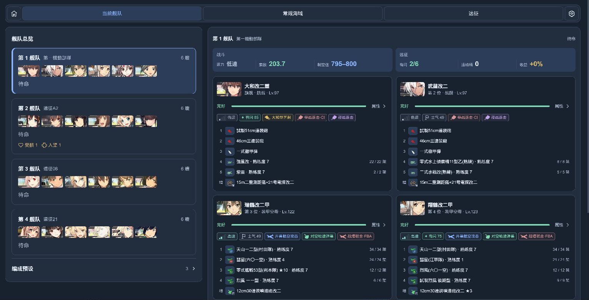

# 舰队参谋 / Fleet Advisor

舰队参谋是 poi 的编成与配装插件。它根据你持有的舰娘和装备推荐常规海域、演习和远征方案，并帮助核对路线、制空、索敌和远征收益。

作者：[virgosnow](https://github.com/virgosnow)。

## 安装

在 poi 的插件管理中安装并启用 `poi-plugin-fleet-advisor`，载入游戏数据后打开「舰队参谋」。已有插件可通过 poi 更新。

[npm 页面](https://www.npmjs.com/package/poi-plugin-fleet-advisor)

## 界面预览

以下为通过 npm 安装的 1.0.0 版本在 poi 中的实际运行画面。

**常规海域**：在地图上查看所选路线、Boss 进度与敌情，在同一工作台核对编成、配装、制空和索敌。

查看当前舰队与远征界面

**当前舰队**：查看四支舰队概况，以及各舰的装备、搭载、耐久和战斗机制。

**远征**：核对出航条件、大成功参考概率、收益装备和补给后的净收益。

## 开始使用

| 页面 | 可以做什么 |
| --- | --- |
| 当前舰队 | 查看四支舰队、装备和战斗机制，以及出击、远征任务目标；点击目标可跳转并预选任务 |
| 常规海域 | 查看路线与敌情，推荐舰娘和装备，核对带路、制空与索敌 |
| 演习 | 查看已同步的对手及其编成，兼顾战斗能力与练级推荐编成和配装 |
| 远征 | 按成功或大成功目标推荐编成，核对条件与补给后的净收益 |

1. 在「常规海域」选择海域和路线，或在「远征」选择目标远征。
2. 按需指定舰娘，再点击「一键补全」生成方案。
3. 查看条件是否满足；可以继续换船、换装或拖拽调整顺序。

远征舰队还在执行任务时，也可以提前补全下一次的编成；应用编成前需要选择当前可用的舰队。
远征推荐只自动配备出航条件、大成功或收益需要的装备，其他装备会从推荐方案中移除；手动保留的装备不受影响。

常规海域中，补全前添加舰娘只显示其当前装备；点击「一键补全」后再统一选船、配装和排序。补全会保留你已指定的舰娘和手动保留的装备，手动选入不代表固定舰位。选择空舰位时默认显示第一舰队、全部舰种；更换舰娘时默认显示全部舰队中与原舰相同舰种的舰娘。舰队和舰种筛选均可手动调整，默认按等级从高到低排列。更换海域会清空该页草稿，切换推荐路线会同步更新编成。

多阶段海域默认展开并计算玩家当前阶段的攻略预设，其他阶段在路线面板中折叠。展开只浏览路线，选中其他阶段的路线后才计算该阶段的方案；同一快照和条件下切回已计算阶段可复用结果。未取得阶段进度时，先按第一阶段规划。不限制每个阶段的推荐路线数量。

登录后，插件会在母港空闲时只读同步海域进度、基地航空队、游戏内编成预设和远征状态；已经由游戏完整返回的数据会直接复用。后续根据相应游戏操作仅刷新受到影响的数据。同步期间不需要打开对应游戏页面，也不会覆盖游戏自身的状态。

当一键补全无法为当前阶段的任何预设路线找到符合条件的编成时，会自动尝试「自适应路线」，根据实际带路规则寻找其他可达路线。它不会作为可手动选择的路线出现，可能经过更多战斗或随机分歧；仍须满足已选任务、舰娘筛选和游戏带路条件，无法保证所有条件下都有方案。

出击设置中的「装备借用」默认允许借用；选择「不借用」时，推荐选船和重新配装只使用仓库及本次编成舰娘身上的装备，队内可以互换装备。设置不会清空已有草稿；手动保留的装备若与借用设置冲突，会提示调整。远征配装不受此项设置影响。

允许借用时，可以从入渠舰娘取得装备；入渠舰娘自身仍不参与默认推荐。远征中舰娘的装备和基地航空队占用的装备不可借用。

路线名称与地图高亮会随当前编成的实际可走分支更新。推荐也会考虑沿途强防空造成的攻击机损耗；敌方特殊对空迎击尚无可靠数值时保留不确定性，不把估算当作保证。

远征可选择「成功即可」或「优先大成功」。净收益已经扣除补给消耗，展开明细可查看各项收入与支出。

「相关任务」会显示已同步的可受领和进行中任务，并核对当前编成要求。游戏登录后，插件会自动在后台同步完整任务列表，供常规海域、演习和远征页共用，无需打开游戏中的任务面板，也无需切回母港。操作或网络暂时繁忙时会等待并重试；正常游戏响应也会更新已观察的数据。

打开插件的演习页面后，插件会在母港空闲时只读同步演习对手及其舰队，无需打开游戏中的演习界面；操作游戏或画面不适合读取时会等待。名单按日本时间 3:00 和 15:00 的刷新周期缓存；对手舰队可能随时变化，插件在演习页面激活时每隔 5 分钟按需重新读取，缓存不保证实时。战况预测按对手本体满改和虚拟参考配装模拟昼夜战，展示参考分布；实际装备、制空与战斗命中未知，结果不是实测胜率。

选择演习对手后，可查看其舰队中的舰娘和等级。参考模拟按舰种、装备资格与槽位构造可开发装备的常见虚拟配装，并据此估算对手火力和航空；该配装不是对手的实际装备，也不使用玩家库存。模拟还按双方编成推定阵形并考虑已知的婚后耐久；对手真实装备、熟练度和对潜本体未知，关键资料不足时不显示概率。预计补给按出击前满补给计算，弹药区分昼战与夜战；铝耗在参考配装可计算时显示有界估算，否则显示理论上限，均不代表平均损耗。经验参考对手前两舰等级、模拟战果、旗舰和练巡加成，并可查看各舰 MVP 经验；模拟仅出现 S 胜时显示约数，悬停可查看波动范围，实际战果和对手编成可能变化。

当前舰队页列出已同步、进行中的出击和远征任务，并展示游戏提供的进度与报酬。装备和其他固定、可选报酬会结合社区资料展示，资料作为参考；游戏返回的可选报酬优先。点击已收录的任务目标，会打开对应海域或远征并预选任务；尚未收录的目标显示为待确认。插件会根据可核实的游戏结果记录目标进度，并以游戏同步状态修正；未观察到的历史进度无法确定，请以游戏为准。

展开「相关任务」后可选择一个或多个任务，随后点击「一键补全」，搜索会同时满足所选任务的舰队编成条件。无法确认或找不到满足全部条件的方案时，会保留当前草稿；切换海域或远征会清除任务选择。

## 应用编成

页面中的调整先保存在草稿里。需要实际换船、换装时，在「设置 → 实验功能」开启「自动操作」，确认方案并选择目标舰队，再点击应用编成。自动操作默认关闭。

运行中可以停止后续操作；已经完成的变更不会回滚。插件支持普通六舰编成，不代为出击、派遣远征或领取任务奖励。

「自动操作」下方的「额外等待」可选择每步增加 0、0.3 或 0.8 秒，默认不额外等待。设置在下次执行时生效，不替代原有画面识别和状态核对。

自动操作采用控件优先、图像识别兜底：先读取游戏当前显示的页面、列表和按钮状态，通常无需截图。控件识别不可用时，会提示切换为图像识别，核对现场并继续未完成的部分；已完成的舰位和装备不会重复应用。两种方式都通过原版界面操作，并保留请求监听、实例与最终状态核对。提交结果不明、状态变化或无法识别安全返回入口时仍会停止。

## 设置与 AI 接入

设置页可调整舰娘筛选、装备借用、计算线程和缓存容量；完整推荐、底层计算和游戏数据缓存可分别清理。游戏数据缓存包含本地任务进度和 MCP 编成方案，清理会删除这些记录。问题排查产生的日志可在「日志缓存」中查看占用并清理。

需要连接 AI 工具时，在设置页启用 MCP，将页面显示的地址填入同一台电脑上的 AI 工具；默认地址为 `http://127.0.0.1:47615/mcp`。远程工具不能直接使用这个本机地址。详细接入方式见 [MCP API](docs/MCP_API.md)。

MCP 可以查询当前可接取、进行中或已达成的任务，并按远征、年常等条件筛选。查询无需打开游戏任务列表；遇到操作或状态变化时返回待重试。任务周期依据资料或游戏标记，目标来自已收录的资料；无法确定时标为未知。

## 使用说明

- 抵达概率只表示带路结果，不包含战斗撤退；制空损耗、攻击力和大成功概率均为参考估算。
- 显示「待确认」表示资料不足，显示参考编成也不代表条件已经满足。应用前请核对页面提示。
- 推荐不保证最优；如果没有找到合适方案，可调整指定舰娘、装备或设置后重试。

## 文档与反馈

- [架构与维护](docs/ARCHITECTURE.md)：配装策略、计算规则、缓存实现、开发与打包方法。
- [数据来源与同步](docs/DATA_SOURCES.md)：游戏、poi、插件记录与内置资料的来源和使用边界。
- [MCP API](docs/MCP_API.md)：AI 工具目录、参数和调用流程。
- [GitHub Issues](https://github.com/virgosnow/poi-plugin-fleet-advisor/issues)：问题反馈与建议。

源码采用 [MIT License](LICENSE)，依赖、游戏素材与数据来源见 [第三方声明](THIRD_PARTY.md)。
