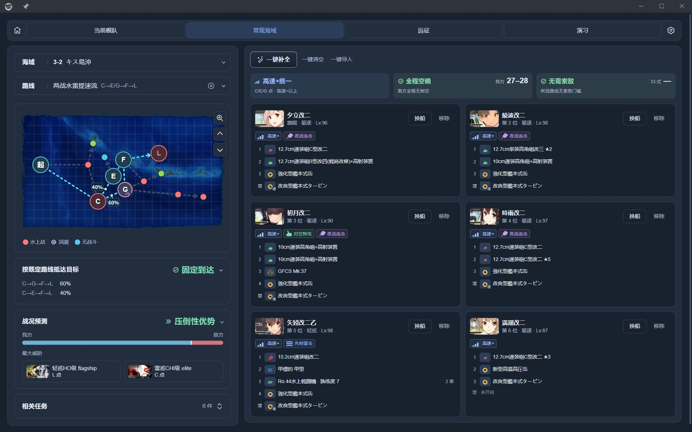
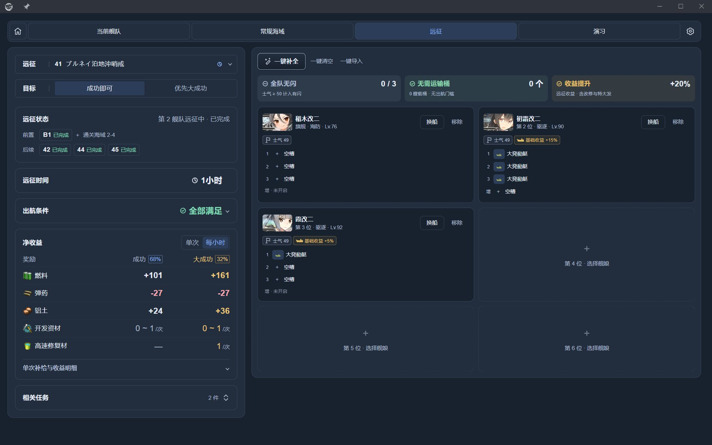
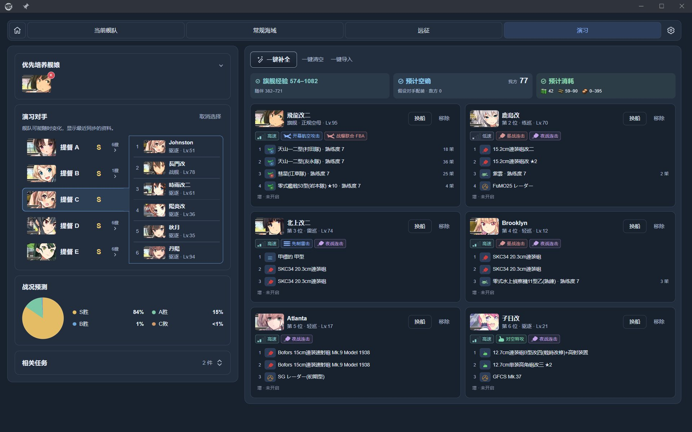

# 舰队参谋 / Fleet Advisor

简体中文 | [繁體中文](README.zh-TW.md) | [日本語](README.ja-JP.md)

『提督、艦隊の編成と装備は、私にお任せください。』 
（提督，舰队编成和配装，就交给我吧。）

舰队参谋是 poi 的舰队编成与配装插件。根据你持有的舰娘和装备，为出击、远征与演习提供推荐，帮你快速检查路线、制空、索敌和收益。

## 能做什么

| 页面 | 功能 |
| --- | --- |
| 当前舰队 | 查看舰队、装备、战斗机制和任务进度 |
| 常规海域 | 查看路线和敌情，推荐编成与配装，核对带路、制空和索敌 |
| 远征 | 推荐满足条件的编成，查看大成功概率与扣除补给后的收益 |
| 演习 | 查看对手，推荐兼顾战斗与练级的编成，参考战况、经验和消耗 |

## 界面预览

截图使用简体中文界面，演习对手的提督名已替换为示例名称。

查看远征与演习界面

## 安装与使用

1. 在 poi 的插件管理中安装并启用 `poi-plugin-fleet-advisor`，载入游戏数据后打开「舰队参谋」。
2. 选择海域、远征或演习对手，按需指定舰娘和任务。
3. 点击「一键补全」，再根据需要调整舰娘、装备和顺序。
4. 核对带路、出航条件和页面提示后使用方案。

已安装的插件可通过 poi 更新；也可查看 [npm 页面](https://www.npmjs.com/package/poi-plugin-fleet-advisor)。

## 设置与补充说明

- **语言和筛选**：支持简体中文、繁體中文和日本語。首次启动优先采用 poi 的语言设置；之后可在设置中切换，并调整舰娘筛选条件。
- **装备借用**：可分别设置是否借用未编队或编队中舰娘的装备；远征中的舰娘不能借出装备，基地航空队装备取用暂未支持。手动保留的装备会在推荐时保留。
- **基地航空队**：在 6-4、6-5 和 7-4 可规划飞机、行动方式和攻击目标；转场与补给可能消耗时间及资源。
- **游戏数据**：登录后后台同步任务、海域进度、基地航空队、游戏预设和远征状态；打开演习页面后同步对手。清理游戏数据缓存会删除本地任务进度记录。
- **AI 工具**：在设置中启用 MCP，把显示的地址填入同一台电脑上的 AI 工具。默认地址为 `http://127.0.0.1:47615/mcp`，支持只读查询、评估与推荐。详见 [MCP API](docs/MCP_API.md)。

## 使用提示

- 推荐不保证最优；「待确认」表示资料不足，请核对页面提示。
- 抵达概率不含战斗撤退。制空损耗、演习战况、大成功概率和交战远征修理费用均为估算；演习预测使用假设的对手配装。
- 任务历史进度以游戏内状态为准。游戏原名保持原样，部分动态规则和诊断说明可能显示原文。

**自动操作默认关闭**，可在设置的「实验功能」中启用，通过模拟点击将方案应用到游戏。该功能仅供开发和测试；自动操作可能违反游戏规定并带来账号风险。关闭它不影响查询、推荐、预览和编辑方案。

## 文档与反馈

- [架构与维护](docs/ARCHITECTURE.md) · [数据来源与同步](docs/DATA_SOURCES.md) · [MCP API](docs/MCP_API.md)
- [GitHub Issues](https://github.com/virgosnow/poi-plugin-fleet-advisor/issues)：问题反馈与建议

作者：[virgosnow](https://github.com/virgosnow)。源码采用 [MIT License](LICENSE)；依赖、游戏素材与数据来源见[第三方声明](THIRD_PARTY.md)。
