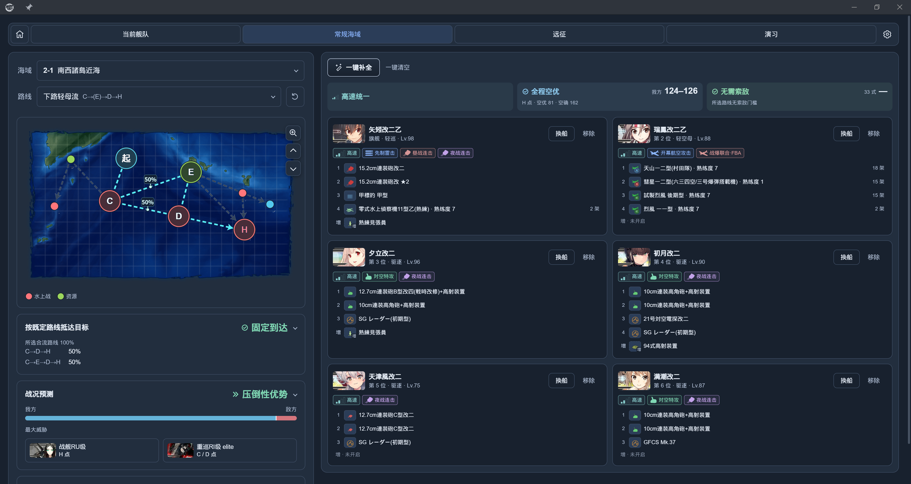
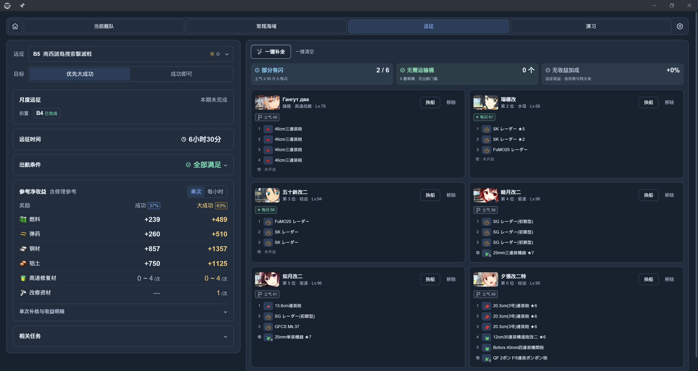
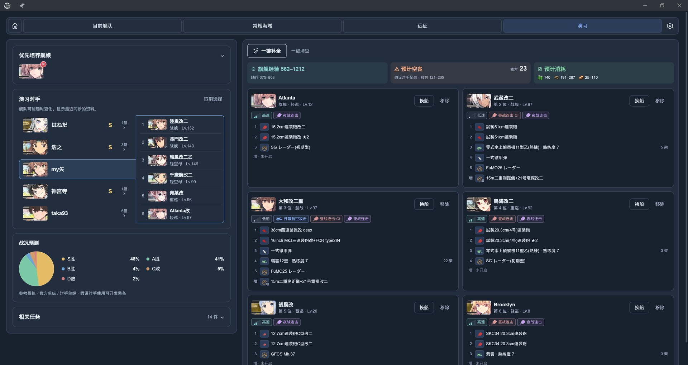

# 舰队参谋 / Fleet Advisor

『提督、艦隊の編成と装備は、私にお任せください。』 
（提督，舰队编成和配装，就交给我吧。）

舰队参谋是 poi 舰娘专用浏览器的一款专注于编成和配装的插件，可根据你实际持有的舰娘和装备，为你的出击、远征和演习推荐专属于你的优化方案，辅助核对路线、制空、索敌及远征收益。

作者：[virgosnow](https://github.com/virgosnow)。

## 安装

在 poi 的插件管理中安装并启用 `poi-plugin-fleet-advisor`，载入游戏数据后打开「舰队参谋」。已有插件可通过 poi 更新。也可查看 [npm 页面](https://www.npmjs.com/package/poi-plugin-fleet-advisor)。

## 界面预览

以下为 poi 中的运行画面。

查看远征与演习界面

## 开始使用

| 页面 | 功能 |
| --- | --- |
| 当前舰队 | 查看舰队、装备、战斗机制和任务进度 |
| 常规海域 | 查看路线与敌情，推荐编成和配装，核对带路、制空与索敌 |
| 远征 | 按成功或大成功目标推荐编成，核对出航条件与净收益 |
| 演习 | 查看对手舰队，兼顾战斗能力和练级推荐编成 |

1. 选择海域、远征或演习对手，按需指定舰娘和任务。
2. 点击「一键补全」生成方案；可继续调整舰娘、装备和顺序。
3. 核对方案条件和页面提示。

手动保留的装备会在推荐时保留。出击推荐默认允许借用其他舰娘的装备，可在设置中关闭；远征中舰娘和基地航空队占用的装备不能借用。远征舰队执行任务时，可以提前规划下一次编成。

登录后，插件会在后台同步任务、海域进度、基地航空队、游戏预设和远征状态；打开演习页面后也会同步对手舰队。操作或网络繁忙时，同步会等待并重试。

在 6-4、6-5 和 7-4，可以规划基地航空队的飞机、行动方式和攻击目标，并参考其对制空与战况的影响。飞机转场和补给可能消耗时间及资源。

推荐不保证最优，「待确认」表示资料不足，请核对方案条件和提示。抵达概率不包含战斗撤退；制空损耗、演习战况、远征大成功概率和交战远征修理费用均为参考估算。演习预测使用假设的对手配装，实际装备和战果可能不同；任务历史进度以游戏内状态为准。

## 设置与 AI 接入

设置页可调整舰娘筛选、装备借用、计算线程和缓存容量。清理游戏数据缓存会删除本地任务进度记录。

需要连接 AI 工具时，在设置页启用 MCP，并将显示的地址填入同一台电脑上的 AI 工具；默认地址为 `http://127.0.0.1:47615/mcp`。MCP 提供只读查询、评估与推荐。详细接入方式见 [MCP API](docs/MCP_API.md)。

**风险提醒**：设置中的「实验功能」提供自动操作，开启后可通过模拟点击游戏界面，将推荐的舰队编成和装备方案应用到游戏中。此功能默认关闭，仅供开发和测试使用；自动操作可能违反游戏规定，并给账号带来风险，请在了解相关风险后谨慎使用。关闭自动操作不影响查询、推荐、预览和编辑方案。

## 文档与反馈

- [架构与维护](docs/ARCHITECTURE.md)：计算规则、实现与开发方法。
- [数据来源与同步](docs/DATA_SOURCES.md)：游戏、poi 和内置资料的来源。
- [MCP API](docs/MCP_API.md)：AI 工具目录、参数和调用流程。
- [GitHub Issues](https://github.com/virgosnow/poi-plugin-fleet-advisor/issues)：问题反馈与建议。

源码采用 [MIT License](LICENSE)，依赖、游戏素材与数据来源见 [第三方声明](THIRD_PARTY.md)。
