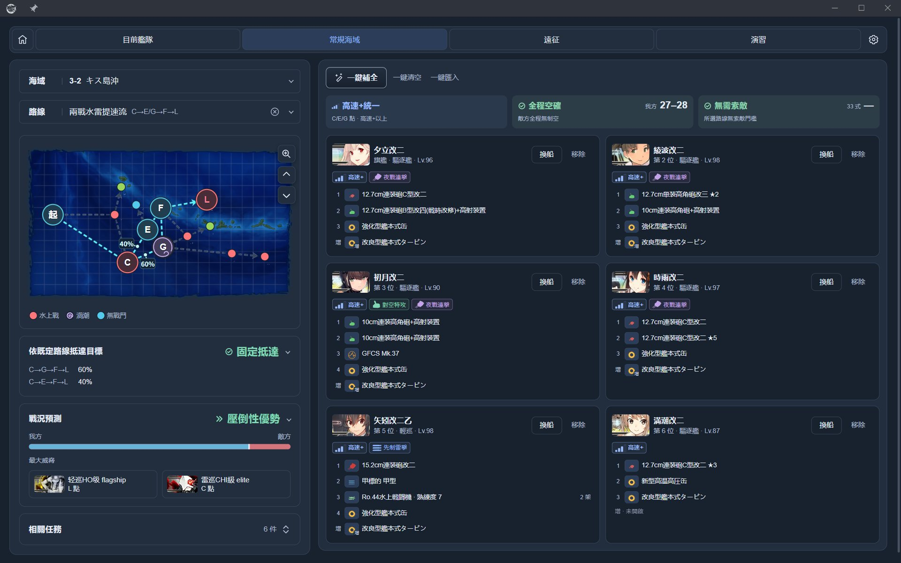
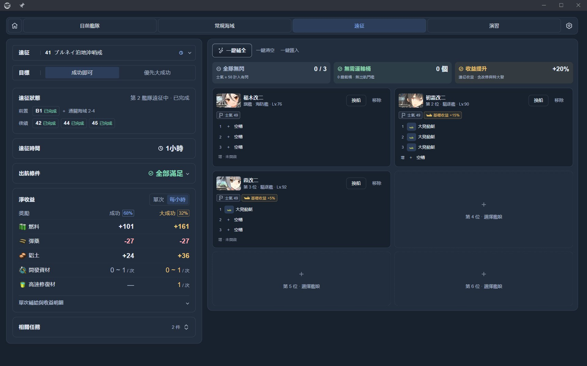
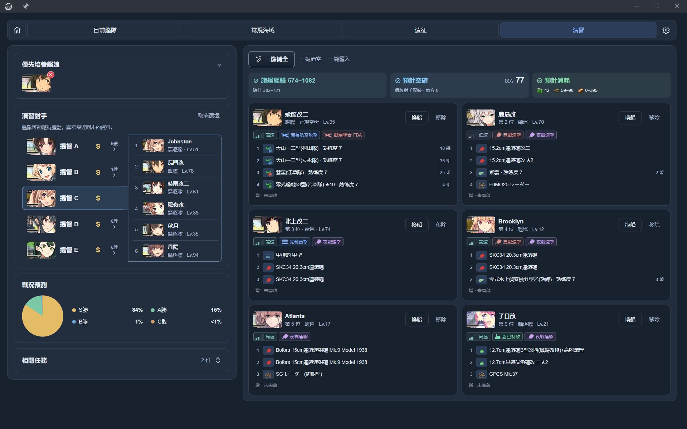

# 艦隊參謀 / Fleet Advisor

[简体中文](README.md) | 繁體中文 | [日本語](README.ja-JP.md)

『提督、艦隊の編成と装備は、私にお任せください。』 
（提督，艦隊編成和配裝，就交給我吧。）

艦隊參謀是 poi 的艦隊編成與配裝外掛。根據你持有的艦娘和裝備，為出擊、遠征與演習提供推薦，協助快速確認路線、制空、索敵和收益。

## 能做什麼

| 頁面 | 功能 |
| --- | --- |
| 目前艦隊 | 查看艦隊、裝備、戰鬥機制和任務進度 |
| 常規海域 | 查看路線和敵情，推薦編成與配裝，確認帶路、制空和索敵 |
| 遠征 | 推薦符合條件的編成，查看大成功機率與扣除補給後的收益 |
| 演習 | 查看對手，推薦兼顧戰鬥與練級的編成，參考戰況、經驗和消耗 |

## 介面預覽

截圖使用繁體中文介面，演習對手的提督名已替換為示例名稱。

查看遠征與演習介面

## 安裝與使用

1. 在 poi 的外掛管理中安裝並啟用 `poi-plugin-fleet-advisor`，載入遊戲資料後開啟「艦隊參謀」。
2. 選擇海域、遠征或演習對手，依需求指定艦娘和任務。
3. 點擊「一鍵補全」產生方案，再依需求調整艦娘、裝備和順序。
4. 確認帶路、出航條件和頁面提示後使用方案。

已安裝的外掛可透過 poi 更新；也可參閱 [npm 頁面](https://www.npmjs.com/package/poi-plugin-fleet-advisor)。

## 設定與補充說明

- **語言和篩選**：支援簡體中文、繁體中文和日文。首次啟動時優先採用 poi 的語言設定；之後可在設定中切換，並調整艦娘篩選條件。
- **裝備借用**：可分別設定是否借用未編隊或編隊中艦娘的裝備；遠征中的艦娘不能借出裝備，基地航空隊裝備取用暫未支援。手動保留的裝備會在推薦時保留。
- **基地航空隊**：在 6-4、6-5 和 7-4 可規劃飛機、行動方式和攻擊目標；轉場與補給可能消耗時間及資源。
- **遊戲資料**：登入後在背景同步任務、海域進度、基地航空隊、遊戲預設和遠征狀態；開啟演習頁面後同步對手。清除遊戲資料快取會刪除本機任務進度紀錄。
- **AI 工具**：在設定中啟用 MCP，將顯示的網址填入同一台電腦上的 AI 工具。預設網址為 `http://127.0.0.1:47615/mcp`，支援唯讀查詢、評估與推薦。詳見 [MCP API](docs/MCP_API.md)。

## 使用提示

- 推薦不保證最佳方案；「待確認」表示資料不足，請確認頁面提示。
- 抵達機率不含戰鬥撤退。制空損耗、演習戰況、大成功機率和交戰遠征修理費用均為估算；演習預測使用假設的對手配裝。
- 任務歷史進度以遊戲內狀態為準。遊戲原名保持原樣，部分動態規則和診斷說明可能顯示原文。

**自動操作預設關閉**，可在設定的「實驗功能」中啟用，透過模擬點擊將方案套用到遊戲。此功能僅供開發與測試；自動操作可能違反遊戲規定並使帳號面臨風險。關閉後仍可查詢、推薦、預覽和編輯方案。

## 文件與回饋

- [架構與維護](docs/ARCHITECTURE.md) · [資料來源與同步](docs/DATA_SOURCES.md) · [MCP API](docs/MCP_API.md)
- [GitHub Issues](https://github.com/virgosnow/poi-plugin-fleet-advisor/issues)：問題回報與建議

作者：[virgosnow](https://github.com/virgosnow)。原始碼採用 [MIT License](LICENSE)；相依套件、遊戲素材與資料來源請參閱[第三方聲明](THIRD_PARTY.md)。
