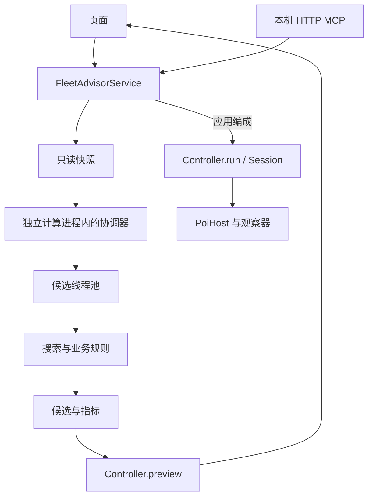

# Fleet Advisor 1.0 架构与维护

舰队参谋是 CommonJS poi 插件。UI、本机 MCP 和推荐 Worker 共用规则与应用服务；游戏操作集中在明确的执行链。React、ReactDOM 和 Electron 由 poi 宿主提供。

## 目录与依赖

```text
index.js                      poi 生命周期与依赖装配
src/
  application/                快照、查询、预览、任务编排
  domain/
    fleet/                    编成计划、装备规则、舰队指标
    combat/                   战斗机制、参考攻击力与标签数据
    routes/                   分岐、路线规划、索敌与制空损耗
    expeditions/              远征条件、收益与配装规则
    quests/                   常驻任务关联与草稿条件核对
  recommendation/             候选、流派、评分与搜索
    loadout/                  通用、对地、对潜与夜战配装
  execution/                  游戏操作、会话、请求及最终核对
  host/                       poi 状态、Electron 与资源适配
  vision/                     图片归一化、观察器与识别 Worker
  infrastructure/
    cache/                    推荐、计算与地图资源缓存
    persistence/              编成方案与远征进度存储
    quests/                   任务列表观察、首次读取协调与内存状态
    workers/                  推荐进程入口、任务队列与候选线程池
  config/                     全局筛选与计算资源设置
  shared/                     名称匹配、错误与纯计算上下文
  bridge/                     HTTP、MCP 协议及工具适配
  ui/
    shell/                    页签、设置和执行反馈
    fleet/                    当前舰队只读页
    workbench/                常规图、远征共用编辑工作台
    expedition/               远征专用视图和显示模型
    maps/                     海图资源、绘制、缩放与加载
    settings/                 设置控件与就近反馈
    models/                   共用只读显示模型
    components/               选择器、标签、拖拽和悬停提示
data/                         规则、敌情、模板与必要图像
tests/                        按职责组织的回归测试
tools/                        test.cjs 及分类维护工具
docs/                         架构和英文 MCP 参考
```

| 层 | 职责 | 依赖边界 |
| --- | --- | --- |
| `index.js` | 生命周期、服务和 Worker 装配 | 不放搜索或战斗公式 |
| `application` | 快照、合同、查询、计划与任务 | 统一承接 UI 和 MCP |
| `domain` | 编成、数值及规则判定 | 不访问 UI、HTTP 或游戏操作 |
| `recommendation` | 组合候选、配装、评分和有界搜索 | 不创建宿主或执行游戏操作 |
| `execution` | 进入画面、调整、等待和核对 | 通过注入的会话访问宿主与观察器 |
| `host` / `vision` | 宿主能力与图像观察 | 不决定推荐策略 |
| `infrastructure` | 文件、缓存和线程生命周期 | 不重定义业务规则 |
| `ui` / `bridge` | 显示与输入适配 | 调用应用服务，共用规则 |

`shared/calculation_cache.js` 只提供可注入的纯计算上下文；磁盘 I/O 位于 `infrastructure/`。`config/` 负责默认值和规范化，不依赖界面或账号存储。

## 查询、推荐与执行



当前舰队读取实际舰队或游戏预设；常规海域和远征维护独立草稿。查询、推荐、装备试配和预览不修改游戏。

常规海域在首次一键补全前只把手动选入舰娘的实际装备复制到草稿，不启动装备推荐或路线／舰队指标评估；换图重新进入该状态。补全成功后换船仍仅重配装备，不重搜舰娘。舰娘选择器默认全部舰种，支持舰种与名称组合筛选，先列第一舰队成员，各组内按等级降序、实例 ID 升序排列。自动推荐筛选条件在选择器中只显示原因，不隐藏或禁止手动选入；远征、入渠和同舰重复等实际不可用状态仍禁选。

常规海域的手动选择保留舰娘及 `keep` 指定的装备，但不锁定舰位：UI 通过 `heldSlots[].holdPosition=false` 允许选船、特殊攻击安排及最终排序移动整舰，合并结果也遵循推荐舰序，并按舰娘 ID 恢复手动装备。应用服务分别核对成员、可选的位置约束和装备归属。MCP 的 `holdPosition` 默认 `true`，省略时兼容原有固定舰位语义；远征工作台仍保留原有固定旗舰与舰位行为。

`domain/fleet/fleet_plan.js` 的 `createFleetPlanner` 生成并验证计划，供推荐器、带路与 `Controller.preview` 复用。`organize_planner.js` 解析编成合法性。`Controller.run` 进入执行链，使用同一计划、实例约束、实时状态核对、执行锁和幂等任务。

请求监测保持被动。取消只停止后续步骤，已发出的游戏请求不能被吞掉、伪造或改写。执行期间保留 UI 布局，只更新进度、计时和停止入口，结束后统一刷新派生信息。

`config/experimental_settings.js` 管理实验权限，`automaticOperations` 默认关闭，旧配置缺失该字段时同样关闭。权限与 MCP 总开关分别持久化。关闭时工作台隐藏整个应用区域，服务同时在面板执行、MCP 新计划执行及异步任务真正启动前校验权限；关闭开关会请求停止当前任务的后续步骤，执行期间保留停止入口。查询、推荐、评价、预览与历史任务查询不受影响，MCP 不提供开启实验权限的工具。恢复推荐默认值不改变这类执行权限。

### 默认筛选与推荐范围

出击与远征分别保存筛选条件。出击默认使用 30 级以上、已改造且可用的舰娘，并排除未锁定、大破和疲劳等状态；远征默认不限等级和改造，但排除远征中、入渠中、未锁定和第一舰队的舰娘。明确手动选入的舰娘可覆盖自动偏好，实际可用性和装备合法性仍会核对。

常规推荐默认最多 5 条路线，可配置为 1–20 条；多阶段每阶段至少保留一条，其余名额优先用于当前阶段。阶段读取 `info.maps.api_gauge_num`，缺失时按第一阶段规划，不推断已解锁。常规与远征线程数独立设置，自动模式按本机可用资源选择。

### 运行路径

插件数据保存在 `~/.poi-plugin-fleet-advisor/`，运行日志位于安装目录的 `logs/`。首次查看海域地图需要已有图片缓存或可用网络；资源加载失败不会清空草稿。

## 推荐模块

公共入口为 `src/recommendation/index.js`。

| 模块 | 内容 |
| --- | --- |
| `context.js` | 可用名册、手动与排除条件、舰娘家族及装备保留 |
| `scoring.js` | 舰体、开幕攻击、空优、昼夜战及特殊攻击评分 |
| `fitting.js` | 制空、提速、索敌与战斗配装候选调整 |
| `strategies.js` | 攻略流派、舰种模板、种子及舰位约束 |
| `normal.js` | 常规候选、批量评估、短名单与最终筛选 |
| `refinement.js` | 同舰种优先的逐舰位升级候选、独立收益合并与家族去重 |
| `route_economy.js` | 所选路线难度分档、逐舰边际收益与轻量化候选 |
| `expedition.js` | 成功／大成功目标、候选、配装与净收益比较 |
| `expedition_candidates.js` | 属性型远征失败后的裸装与可调装候选排名 |
| `loadout/` | 通用及专门装备策略 |

依赖方向为 `context → scoring → fitting → strategies → normal`，后者使用前者。远征主要复用上下文和远征规则。对潜公式在 `domain/combat/asw_combat.js`，实际试配在 `loadout/asw_fitting.js`，规则不反向依赖搜索。

新增机制先区分数值规则与搜索策略。推荐必须尊重手动舰位和装备；特殊攻击重排仅在许可范围内进行，最终核对路线、索敌、制空及可用性。有界搜索失败不证明玩家库存绝无方案。

常规搜索的带路核对通过 `evaluateSearchRoute` 使用最终装备状态投影：仅在不可变快照作用域内、舰娘与所有槽位均指定具体实例时，复用编成校验和装备可用性／适配检查，以唯一实例集合代替通用名称匹配与分配，省去中间搬移步骤。部分槽位、名称或保留原装请求回退完整预览。入选方案仍须经过 `FleetPlanner.preview` 的完整操作计划验证；公共带路查询与搜索使用独立缓存，搜索结果不能代替执行预览。

同一次带路核对只构建一份舰队投影，再交给制空、索敌、速力和先制对潜计算。速力和先制对潜与已有逐舰索敌缓存一样，以舰娘实例及前后完整槽位为键，在不可变搜索作用域内复用；换舰、换装或调整增设不会误用旧读数。缓存有界、不同快照隔离，退出搜索后实时查询重新计算；各项指标与推荐评分保持完整，不省略先制对潜等非带路指标。

航空调装采用航母优先的逐槽搜索：初装舰战从最小的正搭载槽开始，补制空时先升级已有舰战，再使用较小的辅助／攻击槽，达标后优先将较大的舰战槽释放给攻击机。高对空攻击机先按制空增量与攻击损失排序，找到通过沿途核对的最佳单槽替换后停止；保留小槽保护、自动喷气 CI 条件、手动装备与最终索敌／带路核对。此顺序是推荐策略，不代表游戏强制配装规则，也不声称枚举了全局最优组合。

常规航母编队不搜索水战与航母攻击槽的交叉替换，水面舰优先保留炮击、雷达等用途；无航母或仅一艘轻空母时正常考虑水战，并保留小船流为制空腾出必要槽位的能力。其他编队只有航母舰战及高对空攻击机调装后仍未达标，才单向增加水战兜底；不会为可选空确升级启用这个兜底，也不会为增加航母攻击槽而主动加入水战。已有手动水战不会被此偏好删除。水爆仍可因攻击、对地或观测价值参加整套方案比较，但不会作为补制空的战斗机候选。空确升级先检查乐观出击上界：忽略库存竞争与损耗、允许同机种升级，仅牺牲原有可承受范围内的一个非核心攻击槽；即使该上界都不足时才跳过后续升级。水战小船流不使用此航母上界裁剪。

同槽制空贡献仍由 `fleet_metrics.airPower` 逐槽公式提供，装备蓝字对空不加入制空值。`route_air.airContributionKey` 与损耗模拟共用机种、搭载区间、有效对空、熟练度以及喷气机种／钢材等输入，未知数据不归组。`air_fitting` 在当前配装不变时复用数值等价替换的可行性结果；接受任意换装后清空局部表。不同名称的攻击力、索敌、装备加成、适装、所有权及库存实例仍分别评价和分配，不按显示制空整数粗略合并装备。完整推荐缓存通过源码摘要自然失效。

详细性能日志中的 `air.equivalent.hit` 记录这层等价试配复用，`air.supremacy.ceilingReject` 记录空确乐观上界排除，`air.waterFallback` 记录常规航母方案无法达标而进入水战兜底。它们沿用批次、模式、目标、步骤和入口维度，不包含装备名或账号实例；不能把等价命中次数再次算作真实损耗模拟次数。

`domain/fleet/equipment_order.js` 在候选评分前执行同舰装备位置优化：只移动现有实例，在普通槽内枚举合法排列，优先保留攻击机的大搭载量，再提高战斗机搭载量；任何其他飞机的搭载量都不能减少。手动装备、手动空槽、增设、水侦等辅助飞机及航母首槽攻击机保留，按主数据和借装权限检查每个目标槽，不创造新的中间空槽。各舰种共用该规则，随后才对剩余非飞机装备按类别排序。航战主炮不作为航母火力辅助装备移动，保证反复整理稳定。排列和装备归属仅在不可变搜索作用域中复用，实时核验和新快照重新读取。常规推荐最终的预览、路线、制空、攻击评分以及独立配装的返回路径均按实际排列重新核对；远征同样在排序后核对条件。

常规路线的局部升级优先比较同舰种，再保留相关舰种的备选。首轮给每个可调整舰位独立试配机会，均与该轮共同基准比较；次轮合并有效替换，并更新其他路线产生的新优胜编成。未开放补强增设的舰娘用空装备请求表示，不要求开放增设。每条路线最多 8 次局部试配，默认五条路线合计最多 40 次；玩家显式增加路线数量时，按同一单路预算扩展。每个结果仍核对库存、手动条件、制空、索敌、到达率及执行预览。合流路线优先最终 Boss 到达率，到达率相同时以战力为主，单支线概率只作小幅排序参考。

`route_economy.js` 按实际选定节点分档并在不可变路线资料上复用结果。普通／标准水上路线分别采用逐舰 260／320 的启发式战力拐点，超出部分保留 10%／20% 权重，燃弹消耗权重为 10／8；这些是排序策略，不是游戏公式或达标线。大槽攻击机与先制雷击的出手机会另计，避免伤害饱和连带抹去开幕压制价值。特殊炮击的过剩收益同步折减。高威胁、夜战、对潜、对地或敌情不确定时不启用该省耗评分，1-1 保留专门策略，显式的传统最强推荐也保留原语义。

轻量化复用 `refinement` 的真实库存试配，最多每路线 4 次。仅对昂贵的战舰／航战／航母提出明显节约的替换，候选裸舰战斗能力至少达到目标舰种可用最强者及原舰饱和能力的 85%；不会为省耗降级驱逐或海防舰，最后的护航强化也适用于高难度水上及对地路线：试配更强驱逐替换薄弱驱逐或海防，并保留联合替换和单舰替换供对潜／Boss 评分比较；这不启用高难度路线的省耗替换。纯对潜路线保留专用策略，手动舰娘不变。所有替换均重新核对到达率、带路、索敌、制空与攻略要求；低成本空确已达成时保留空确。`scores.routeEconomy` 为策略诊断，`search.lightening` 记录额外尝试与有效候选数。

### 常规配装策略

本节区分游戏机制与自动配装策略。小槽范围、代价上限和制空余量属于推荐用的启发式参数，不代表胜率或实战保证。

#### 潜艇

潜艇与潜水空母达到 10 级后自带先制雷击，自动配装优先两枚鱼雷，不再为开启先制雷击占用甲标的槽位。潜艇电探优先放入允许装备的增设槽；否则在双鱼雷以外的空余普通槽考虑。未满 10 级时仍可用甲标的开启先制雷击，手动指定的装备与空槽照常保留。

#### 航母搭载槽

航母自动配装将 10 架及以下作为保守的小搭载槽范围，优先用于舰战、舰侦或合法的火力辅助装备，攻击机优先放入大格。空优达标后不会再把小格舰战换成额外攻击机；只有小搭载槽的早期航母仍会保留攻击能力。这是配装策略，不代表更大的槽位不会被打空，手动指定仍优先。

#### 索敌与辅助装备

索敌调装按路线节点的实际系数和门槛补足，达标后停止增加，不为堆高索敌挤掉攻击机。确有缺口时先调整辅助装备，再考虑攻击机槽位；控索敌路线继续核对上下限。彩云仅在实际索敌缺口需要时考虑，全队最多自动配一架，放最小合法的非零搭载槽；不为避免T不利强制携带。索敌足够时优先攻击与整备员等火力辅助装备，调整后重新核对沿途制空，手动指定的装备不变。副炮与整备员优先零搭载槽或小槽，腾出的较大槽位留给舰战和攻击机。

#### 航战

航战的观测装备与舰上侦察机分开选择：水爆兼顾开幕攻击与弹着，水侦用于观测和索敌，也会比较合法的舰爆搭配水侦／水爆。攻击飞机优先大搭载槽，各方案共享库存并重新核对制空、索敌、速力与带路条件；不会把彩云当作弹着观测机。航战舰爆按实际机种计入开幕航空攻击评分。

#### 空优与低代价空确

默认保空优，也会比较低代价空确：单航母可调整舰战或辅助槽，保留全部攻击机槽；多航母保留每艘的大格舰攻与舰爆，相比空优方案最多减少一格额外攻击机。航空攻击评分下降不超过 15%，至少保有一格（多航母为两格）有效对空不低于 10 的舰战，并确认所选路线各点的保守制空估算均达空确。条件不满足时保留空优方案；明确选择「空确」时仍按指定目标调装。此上限是推荐策略，依据 [Wiki 航空战](https://wikiwiki.jp/kancolle/航空戦#AirSupremacy)与[昼战特殊攻击](https://wikiwiki.jp/kancolle/戦闘について#Observation)的收益取舍制定，不是游戏固定阈值。

#### 爆战

调装会比较 [F4U-1D](https://wikiwiki.jp/kancolle/F4U-1D) 等高对空舰爆的轰炸与制空收益，先尝试同机种替换弥补制空缺口，再考虑减少攻击机换舰战。爆战在战爆联合中按舰爆 B 计，不当作舰战 F，也不能免除对空炮火损耗；F4U-1D 的对地能力另由目标类型核对，对陆上目标不发动战爆联合 CI。

#### 制空余量

无喷气机时，利用爆战补制空缺口仍采用原有策略：纯舰战／水战的沿途保守制空至少承担目标的 80%，计入攻击机后各点还须高出目标至少 20%。喷气方案改用分阶段损耗后的逐点保守制空下限直接核对，不另叠加这一固定余量。防空资料缺失时不能确认沿途达标；这些区间与策略不代表全灭概率或实战保证。

### 喷气航空

`domain/combat/jet_aviation.js` 是舰载喷气机的共用事实入口：56 为喷气舰战、57 为喷气舰爆、58 为尚未支持的喷式舰攻。199／200／548 分别收录钢耗、机种及射击回避；装备资格继续由主数据和 `equipment_rules.js` 判断，不按装甲空母舰种一概放行。标签、开幕攻击、战爆联合和路线损耗复用这一入口，未知机型不套用 57 的规则。

强袭基础攻击力为 `爆装 × √残机数 + 25`，不加触接或装备蓝字；普通喷气舰爆航空攻击先乘 `1/√2`，再应用 170 软上限并取整。普通航空攻击已有的蓝字／航空人员效果由原模块计算。这里显示的是未扣甲的基础参考，不是命中、暴击或保证伤害。喷气 CI 的攻击倍率 1.35／1.30／1.27 与发动判定常数 135／125／115 分开保存；喷气舰爆不充当普通 FBA 的 B。

`routes/route_air.js` 对有喷气机的候选按路线逐点执行：

1. 排除纯潜艇、空袭、开幕夜战及非战斗节点。钢材大于零时，以本战开始残机数逐槽四舍五入计算钢耗；不足完整费用仍允许本战强袭，资源扣至零。
2. 喷气阶段先算仅喷气机参加的比例损耗，再算喷气舰爆的对空迎击，得到各槽强袭攻击力。无敌方喷气机时取空确的比例损耗区间；存在敌方喷气机时不套用未验证的相互迎击公式。
3. 使用喷气阶段损耗后的所有飞机判断同一点普通制空，Boss 点同样执行。普通航空战再算比例损耗及攻击机迎击，喷气机比例损耗按 60% 处理，在最终取整前乘入。喷气舰战仍按舰战处理，不承受攻击机的对空炮火。
4. 已收录射击回避分别作用于加重对空和舰队防空并取整；景云改为 0.5／0.7，橘花改为 0.5／0.5。下界取已收录最强迎击，上界不计迎击成功，不给区间附会概率。旧式只有汇总值的防空输入采用不减免迎击的保守上限。

普通航空战也记录末节点的攻击机存活，供评分使用，但 Boss 制空读数始终取本点普通制空判定前的时刻。不会模拟喷气攻击提前击沉敌舰来削低敌制空。特殊防空、敌方喷气迎击、机型、容量或钢材资料不足均给出具体原因；不能据此认定已满足沿途制空。无喷气机继续使用原来的快速路径。

`loadout/jet_fitting.js` 在真实库存实例、装备资格和手动槽位约束内生成最多 12 个喷气／常规及混合候选；不自动把喷气攻击机塞进受保护的小搭载槽。`scoring.js` 将普通航空与强袭分开计分，使用逐点残机数、逐槽攻击、条件 CI 和整次出击钢耗比较整套收益。钢耗由路线模拟的每战消耗累加，区间取中点、不同路径取平均；每点钢耗仍保留供诊断，评分不再把总费用平均成一战。每单位钢扣 0.10 个航空排序分（700 钢为 70 分），是降低资源密集方案优先级的推荐策略，不是伤害公式、资源兑换率或概率。损耗资料不全时使用满载费用上界作排序参考，实际钢耗读数保留未知及原因，不能当成零费用。评分不保证全局最优或最终伤害。候选仍须经过完整带路、索敌与制空核对；手动指定的喷气机不因消耗偏好而删除。喷气舰战只贡献制空、存活和可能的 CI，不产生虚假的对舰攻击。

`loadout/carrier_policy.js` 集中执行喷气选择策略：每艘新增自动喷气装备的航母必须具有 FBA 或共享机制数据收录的喷气 CI，不能借用其他航母的组合或用 BA／BBA 降级放行。普通补全以非喷气配装为起点；喷气搜索保留少量暂未组成 CI 的内部试配，原子生成 jFjB、jFjBjB 等组合，最终候选才输出。制空调装逐次核对组合，整套推荐与独立配装再次核对，手动槽位按装备实例豁免，不豁免同舰额外的自动喷气装备。

航母小搭载槽统一由 `SMALL_CARRIER_SLOT=10` 定义：10 架及以下保护，11 架及以上参加普通与喷气攻击机试配。补全、制空调装、喷气组合及低代价空确评价共用同一阈值。补制空先替换非攻击槽，仍需调整攻击机时优先较小槽，尽量保留最大槽的攻击力。喷气 FBA／CI 组合在后续调装及最终评估中继续核对；沿途损耗与制空使用原有路线模型。手动槽位仍优先。该阈值是推荐策略，不是游戏固定限制或全灭概率。

路线损耗缓存键包含机型、容量、对空、熟练度、爆装和钢材；喷气逐槽报告另包含舰娘与槽位身份，换位后不会复用旧位置的攻击报告。残机上下界可能在不同节点耗尽钢材，此时强袭机会按包含零的保守区间处理，不输出倒置区间。完整推荐缓存的实现指纹覆盖新模块。没有按海域硬编码喷气偏好，也不改变基地航空队、航空支援或游戏执行。

对地与航空调装共用不可变搜索中的中间结果：完整对地调装按编成、库存列表、敌情、航空参考、手动槽位和搜索模式缓存，返回副本以隔离后续修改。对地攻击基础数值按舰娘、配装、旗舰和火力回退值复用，目标倍率按敌舰类型分别计算；航空状态及舰队索敌决定的观测发动率仍逐候选应用。航空阈值检查只有遍历全部适用节点成功后，才保存已得到的空优／空确精确最小余量，供其他阈值与后续调装使用；提前失败不保存不完整余量。新快照和实时调用不复用搜索缓存，全部最终带路、制空和库存核对保留。

对地调装只有发现合法、未占用的试换装备后才准备整队上下文和基准分。同一搜索内，库存效果分组、稳定排序及逐舰逐槽的合法实例列表共用；实际库存占用、手动槽位与分组代表实例仍在每个分支重新选择。整队上下文按完整舰序、配装、路线敌情及航空参考匹配，保存独立舰娘槽位副本，最多保留 256 项；接受换装或调整舰序后使用新键，不把旧制空、索敌或旗舰条件带入新方案。未处于不可变搜索作用域的实时调用仅在单次调装内复用，不跨调用保留。初配三轮、精修六候选宽度和昼战／夜战／专精三种结构均不因缓存改变。

制空调装的水战／攻击机互换按完整收益分层检查：高分层找到可行组合后停止检查低分层，同分时仍使用原有舰位、库存和装备顺序。装备适配列表按等效组保存合法实例，挑选时重新核对占用与借装权限，并按第一个可用实例的位置恢复库存顺序；不会把分组当成增加库存。逐舰索敌读数、对地评分和相同候选的路线评分只在不可变搜索作用域内复用，对地键保留目标、制空、舰队索敌和旗舰条件，路线评分区分路线结果、敌情、配装与舰娘上下文。实时调用和新快照仍重新计算。详细调试模式单列航空辅助槽整理、补制空、释放攻击槽、水战互换和空确试配五个阶段；普通阶段模式不启用这些逐模块时钟。

制空调装在既有 `withEquipmentIndexCache` 不可变快照作用域内复用逐舰逐槽的制空贡献和装备资格，以及同一库存列表的分类、排序与等价键。试装只临时改变槽位；未改变的整队制空读数复用，试装返回或实际替换后正确恢复／失效。已占用实例、借装所需条件和手动保留每次重新核对，不缓存库存分配或跳过候选。喷气评分复用逐舰投影和相同完整配装／CI 组合的攻击力，舰队索敌项、沿途制空与最终评分仍按当前候选计算。作用域结束即释放，实时调用及下一次搜索重新读取，不新增磁盘缓存或玩家设置。

银色标签复用既有样式，独立图标为 `data/icons/material/jet-assault.svg`。它来自内置 image_gen 生成的原创俯视双发喷气机，提示要求为“对称、清晰宽机翼、无螺旋桨／徽章／文字、白色透明底剪影，适合 18×14 像素”；再提取透明轮廓并简化，不引用游戏喷气图标。原始生成图和研究输入保存在项目外，不进入发行包。

### 远征配装与收益

远征净收益下可展开单次明细，按资源对照成功与大成功的基础收益、大成功加成、收益加成和补给消耗。收益加成包含装备、改修、组合与舰娘自带加成；消耗以红色负数显示，各项合计为上方对应的单次净收益。

“成功即可”优先使用无闪舰娘；满足出航条件和收益配装后，对运输桶能提高大成功概率的远征，会利用空余槽位补足有效桶数。桶数不足以提升概率时不额外携带，也不会挤占达标装备、收益装备或手动保留的槽位。无闪舰娘无法满足条件时仍可使用有闪舰娘，玩家指定的舰娘不变。“优先大成功”则优先提高大成功概率。

月度远征数值模型在 `domain/expeditions/expedition_stats.js`：从观测面板还原本体与蓝字，按候选装备、远征改修和满搭载数投影；未完全确认的飞机贡献使用保守下限。`recommendation/loadout/expedition_stats.js` 在真实库存、适配、运输桶与手动槽位约束内做缺口搜索，局部停滞时有限尝试联合换装。候选船组不能因现有配装未达标就提前丢弃；自动调装与收益配装完成后再次统一核对。该计算缓存只属于当前只读快照，键包含完整槽位。

常规短名单调装仍未达标时，`expedition_candidates.js` 才生成独立的裸装与适配槽位潜力排名，重试被当前面板排名遮蔽的舰娘与旗舰。潜力只用于排序，不作为达标依据；库存共享、蓝字及实际合计属性必须重新配装核对。短名单按船组去重，失败后最多保留两组各 64 个备用船组，先试前 12 个，仍失败再扩展。`search.fitted` 为已完成配装核对的不同船组数，`search.rescue` 表示是否启动第二轮候选搜索。

属性型远征优先满足普通成功条件。运输桶优先放在属性装备适配潜力较低的槽位，避免把少数能装声呐、电探的槽位全部占用。大成功额外运输桶使属性无法达标时，退回必需桶数重试，手动指定的桶不移除。装备短名单停滞后再展开同属性候选和已收录蓝字联动条件所需装备，避免把零白字但有用的电探等装备提前过滤；仍不保证全局最优。

## 计算进程、线程与缓存

`infrastructure/workers/recommendation_worker.js` 串行管理 UI / MCP 推荐请求、取消和缓存维护，并提供共用计算入口。poi 通过 `host/recommendation_process.js` 在主进程中托管 Electron `utilityProcess`，每个请求使用独立进程；`recommendation_process_entry.js` 在其中直接运行协调器，`recommendation_pool.js` 保持现有候选线程池。主进程只负责启动、传输和回收，不运行搜索。仅快照、任务和结果跨进程，在线宿主、控制器及账号存储服务不跨边界。离线 Node 测试和工具仍使用同一实现的协调 Worker。

进程通过就绪握手接收一次快照，正常结束后回收整棵计算线程树并释放搜索内存，确认退出后才交付结果及处理下一请求或缓存清理。`cancel()` 取消当前与此前排队的推荐，后续请求可重新启动；`dispose()` 同时关闭队列。异常退出、计算错误与启动超时拒绝本次请求，下一次重新创建进程，不偷偷返回部分结果或重试整次搜索。终止失败时重试回收；仍不能确认退出则关闭该队列并提示重启 poi，避免并存写入者。页面销毁、刷新、渲染进程崩溃和 poi 退出由主进程独立回收，插件卸载同时释放主进程模块缓存。启动握手限时 30 秒，搜索本身不设置任意耗时截断。

`RecommendationProcessHost` 为可见的常规／远征工作台共用一个空预热进程。应用层合并同一次页签切换的激活和释放事件，当前舰队、设置及隐藏工作台不预热。预热只加载推荐模块，不读取账号快照、计算缓存或建立候选线程池；进程就绪后最多闲置 60 秒，超时不会自行重新拉起。一次搜索完成后整个进程仍回收；工作台保持可见且队列已排空时，另建一个空进程供下一次调整使用。离开页面、取消或卸载会回收空进程，预热失败允许后续冷启动。任务分配与发送分开，先注册结果／异常／退出监听再发送，防止热缓存结果过快而丢失。

常规线程可自动选择或指定 1–8，远征使用独立的 1–2 线程设置，实际数量受可用处理器限制。进程隔离不改变候选顺序、枚举预算、评分、手动槽位、库存分配或带路／制空／索敌核对；线程设置仍只控制原有并行计算预算。

| 缓存 | 键与复用 | 必须重新执行 |
| --- | --- | --- |
| 完整推荐 | 完整快照、参数、设置和实现指纹 | 输入变化后的搜索 |
| 底层计算 | 依赖明确的纯计算特征 | 实例分配、库存与状态、评分和最终核对 |
| 编成方案 | 临时完整方案，最多 200 条 | 应用前的预览与实时核对 |
| 日志 | 默认关闭的本地性能报告 | 不参与推荐；不会替代状态与库存核对 |

四类缓存由 `cache/disk_cache_budget.js` 共用 `cacheLimitMiB`，不分别预留字节配额。完整推荐、底层计算与日志各保留最多 64 个文件及 7 天保留期。实现指纹覆盖 `src/` 和 `data/`，输入或实现变化使对应结果失效。

同一搜索中的完整带路核对按查询参数与完整编成复用，候选输入按手动约束与保留配装方式区分，避免重复补装后才发现候选相同；候选输入表最多保留 4,096 条。蓝字按舰娘形态、装备实例、改修及属性筛选复用。路线遍历单独保留最多 512 组出口状态，包含阶段、目标、零概率分支与 7-4 的路径相关索敌条件，所选路径过滤不修改公共记录。编成预览的装备归属使用初始索引加本次试配移动记录，逐次生成借装和卸装步骤；实时调用及新快照重新读取。线程回收时只汇总新增装备适配事实，不重复传输从磁盘读入的整张表。

搜索内存索引仅限不可变快照的同步计算作用域：同一任务的分批计算共用筛选后的舰娘目录、库存归属及对潜读数；每次新搜索重新建立，界面预览与执行不复用这些索引。沿途制空试配共用每个 Worker 最多 16,384 条时钟淘汰余量记录；键保留机数、机种、对空、熟练度、喷气型号与钢材，省略不影响损耗的舰娘身份及爆装。同一物理飞机状态使用不重复分配的数值标识，避免反复拼接长键；标识表独立限量，淘汰只损失命中率，不允许旧记录错认新状态。完整逐点报告另保留舰娘、槽位和攻击力信息。实际库存分配、手动槽位与最终核对始终重新执行。

`infrastructure/workers/batch_transport.js` 为每个候选线程按批次登记一次公共参数、路线和流派配置；后续小任务只发送批次编号及本次条目，候选和完整数值报告继续使用原生结构化复制。同一请求的快照在首次创建候选线程时只序列化一次，编码写入共享字节缓冲区，各线程通过原生反序列化分别建立独立对象；不共享可变的舰队、库存或索引对象。线程回收后释放字节缓冲区，调试计数 workers.snapshot.bytes 记录单份大小，workers.snapshot 记录编码耗时。登记边界是每次批处理调用，即使调用方复用批次对象，更新的阶段和手动约束也会重新传输。调试计数 workers.header.sent/reused 记录登记及复用次数。

### 搜索计算复用

推荐计算分开处理搜索结果、判定所需的最小读数和最终展示报告。`loadout/air_fitting.js` 负责飞机试配，`fitting.js` 保留带路装备及水面配装；两者通过原有入口组合。`loadout/search_memo.js` 仅在一次不可变快照搜索内复用完整输入一致的试配，键包含舰位、装备实例、手动槽位、库存目录、路线、目标与受保护攻击槽，返回副本以隔离后续修改。跨快照不复用库存分配。水面配装和带路装备试配也按完整输入复用。候选评价器按完整查询和库存目录复用初始化上下文，包括装备索引、攻略策略和候选缓存；每次仍按完整舰位、装备实例和手动槽位决定命中或重新配装，最终实例分配与执行预览保持原有核对。各线程在一个请求内保留静态带路规则的准备结果，不缓存变化的舰队结论。飞机库存分类、舰娘槽位合法装备列表和所选路线的对潜节点在搜索作用域内复用；来源舰队例外、手动槽位、已占用实例和 CI 条件仍按当前试配核对。当前配装未接受替换前可复用备选列表，接受替换后立即失效。水战与攻击机联动试配按相同评分稳定排序，首个通过完整制空核对的候选确定后跳过不可能胜出的较低分候选。试配先用出发制空上界排除必定不达标的替换，未知模拟保留原有回退条件；通过这个必要条件后仍完整核对沿途损耗。

`domain/routes/air_margin_plan.js` 将同一路线的共享前缀和逐槽整数损耗编译为可复用的计算计划。仅起点等非战斗分支不同、实际战斗序列完全相同的路线共用数值试算与余量缓存；节点敌情必须相同，逐点展示报告仍按各自路线保留。它调用完整报告相同的制空状态、取整及喷气迎击公式；已确认节点的整数转移表按节点共用，只按实际访问的制空状态、上下界与机数分段扩展，飞机贡献按完整数值签名共用并限制数量。试配只要求下界时省去上界计算；仅询问是否达标时，遇到第一个不达标节点即返回否，不把中途读数作为最终余量缓存。未知敌情、未知喷气型号／钢材等情况回到原有完整模拟器；无法判断的布尔查询返回 `null`，由调用方沿用原有未知资料策略。最终评分和展示继续生成完整逐槽报告，包括 Boss 点喷气阶段。

带路评估在一次舰队核对内共享节点判定，路径依赖条件按它实际引用的经过点区分，未知经过历史与空历史不合并。候选子线程同时准备所选路线的评分，协调线程仍按原顺序筛选、处理并列结果和执行最终预览。候选数量、枚举顺序和所有搜索预算保持不变。

最终舰序由 `recommendation/fleet_order.js` 在选船和全部配装结束后处理，只移动舰娘及其整套装备。复用弹着、航母 CI、夜战 CI 与实际对地目标的攻击力和固定条件发动率，比较第二轮炮击、夜战先手及旗舰补正；这些位置权重是推荐策略，不是击沉率。每个可用旗舰只生成一个最优自由舰位排序，最多六个方案再核对实际带路、Boss 到达率、索敌、沿途制空、特殊攻击和执行预览，不重新搜索装备。保留明确要求锁定的舰位、已有特殊攻击的参与舰站位，以及对潜目标的原有专用排序；常规工作台手动选入的舰娘参与统一排序。`search.fleetOrdering` 记录尝试、接受与保护次数，`selection.fleet-order` 单列此步骤耗时。

较强威胁路线只有一艘明显脆弱的水面舰时，还会比较旗舰保护方案。必须同时满足低回避与低装甲：最终配装回避估值低于 60、且低于其他舰中位数的 80%，最终配装装甲低于其他舰中位数的 80%；缺少回避或装甲数据时不自动认定需要保护。再用满耐久 × 最终配装装甲筛选单一离群舰，要求至少四舰、其耐久指标低于其他舰中位数的 55%，且次弱舰至少为其 1.6 倍。夕立改二等高回避轻型舰不会仅因耐久和装甲较低而得到保护优先权，仍可因攻击力或旗舰 CI 收益担任旗舰。上述阈值是排序策略，不是命中率、真实生存概率或游戏机制；保护不覆盖手动位置、带路旗舰及特殊炮击约束，也不承诺一定触发僚舰庇护。机制来源：[战斗流程](https://wikiwiki.jp/kancolle/戦闘について)、[夜战](https://wikiwiki.jp/kancolle/夜戦)、[攻击对象选择](https://wikiwiki.jp/kancolle/攻撃対象の選択)。

### 性能打点

`shared/performance_trace.js` 提供默认关闭的打点。实验功能中的 `performanceDebug` 开关持久化；开启后使用 `modules` 档，并由 `cache/performance_logs.js` 以严格字段白名单写入 `recommendation-cache/logs/`。日志不进入推荐结果、完整推荐缓存键或结果缓存文件，也不记录快照、舰娘和装备实例、昵称、请求正文。单份上限4 MiB；原子写入失败只在日志缓存行提示，不影响推荐。日志写入在同一推荐队列完成后才释放本轮任务，避免清理后旧报告重新出现；关闭开关会跳过尚未开始的日志写入，已写入文件仍保留。

常规推荐记录完整阶段和候选子线程；同步推荐和远征额外提供整体搜索阶段。开发者也可只在内存保留最近一份报告，临时从 poi **主窗口**开发者控制台开启；此入口自身不持久化，重启或热更新后恢复：

```js
var root = window.getStore().plugins.find(p => p.id === 'poi-plugin-fleet-advisor').pluginPath;
var timing = require(require('path').join(root, 'src/shared/performance_trace'));
timing.setEnabled(true); // stages：轻量阶段计时
// timing.setEnabled(true, {level: 'modules'}); // 逐模块计时，额外开销较大
// 正常触发一次推荐后查看；命中完整缓存时报告只会包含缓存阶段
timing.summarize(timing.getLastReport());
timing.setEnabled(false);
timing.clear();
```

程序调用可给 `RecommendationWorker` 传入 `getDiagnostics: () => ({level: 'stages'})` 或 `modules`，通过 `lastProfile` / `onProfile` 读取报告；`getDiagnostics: () => null` 可强制关闭。独立 Node 进程也支持 `FLEET_ADVISOR_PROFILE=1` / `modules`。离线复现使用 `node tools/bench/profile-recommendation.cjs --store <私有快照.json> --area 4-5 --output <项目外报告.json> --threads 6 --level stages`。该工具默认关闭完整结果缓存以测量重算；可用 `--cache <私有目录>` 复用底层缓存，用 `--result-cache true` 测量完整缓存命中。

报告的 `elapsedMs` 为调用方启动计算进程（离线为 Worker）至收到结果的等待时间，排队时间单列在 `queueMs`；`startupAndTransferMs` 为此时长减协调 Worker 内的时长，包括原生线程启动、输入复制与结果传输等，不能进一步冒称精确的单项复制时间。`stages` 是按执行顺序记录、互不嵌套的等待时间，含候选生成、装备试配、逐路线修补、筛选、缓存和线程收尾；未归入阶段的少量协调开销在汇总中单列。

`teardownMs` 单列收到结果至确认进程／线程退出的时间；`runtime.execution` 区分独立进程与离线 Worker，独立进程的 `peakRssMiB` 包括其中所有候选线程。`runtime.prewarmed` 表示请求分配时空进程是否已经就绪，`preloadMs` 为启动时模块加载耗时；进程在等待玩家操作期间的闲置时间不计入 `workerMs`。冷启动时，提前加载的代码耗时归入调用方的 `startupAndTransferMs`。调试日志写盘发生在结果收到和进程回收之后，不计入上述计算时长；推荐队列等待写盘结束后才交付结果及处理清理请求。不能在 `onProfile` 回调中再等待同一个推荐队列的 `maintain()`，否则会形成循环等待。

`modules` 的 `totalMs` 包含子模块，`selfMs` 扣除子模块；各线程的累计时长允许超过用户等待时间，且是线程内经过时间，**不是操作系统 CPU 时间**，不能与阶段等待时间相加。子线程初始化和 `dispatch` 往返时长均已包含在对应批次的等待内；汇总它们只用于观察任务不均衡及通信开销。`air.trial.hit/miss/fullHit`、纯计算表命中统计帮助区分缓存命中与实际重算。逐模块模式会增加高频调用开销，分析耗时占比优先使用阶段模式，并用关闭打点的同快照测量校准；开启打点不会跳过缓存或改变候选、库存分配及最终核对。

详细制空查询记录使用固定维度后缀 `批次.搜索模式.制空目标.调装步骤.检查入口`：批次包括 `gear`、`gear-final-ground`、`path-fit`、`refinement` 等，搜索模式区分 `requested` 与 `optional-supremacy`，步骤区分 `utility/cover/release/pairs/other`，入口区分直接查询 `direct` 与喷气支持条件复核 `support`。`air.query` 记录调用数和累计时间，`air.query.hit/miss/pass/fail/unknown` 分别记录缓存与判断结果；同一调用的结果维度与缓存维度不能相加。`air.attempt`、`air.departureReject` 记录进入试配及查询前淘汰；`air.pairs.generated/tested/accepted/round` 区分双槽候选生成、实际逐水战测试、接受换装与迭代次数，生成数不包含水战备选的展开倍数。`air.supremacy.attempt/accepted` 是实际进入空确升级及被该次调装接受的次数，不代表最终推荐数。`air.support.departureBelowThreshold` 只观察喷气支持复核前出击制空已低于参考门槛的情形，不改变判断或提前返回。

对地准备复用由 `ground.inventory.build`、`ground.eligibility.build`、`ground.context.hit/miss` 和 `ground.noCandidates` 计数：分别表示库存目录构建、合法实例列表构建、整队上下文复用/构建，以及初配中没有可试换装备而跳过评分准备的逐舰访问。多线程报告汇总各线程独立缓存，构建数不代表不同舰队或实际出击次数。

`route.evaluate` 中的 `route.plan`、`route.projection` 和 `route.metrics` 分别记录候选状态校验／计划、舰队投影和整套指标计算，便于区分准备成本与后续分岐遍历。搜索投影与最终完整预览的用途不同，减少操作计划构建不表示减少带路规则核对。

上述细分仅在 `modules` 模式启用，不保存舰娘、装备实例、完整配置或查询签名。`withDetails` 只供同步嵌套计算使用，以 `finally` 恢复外层归属；不要包裹跨 `await` 的异步工作。通常模式与 `stages` 模式不建立归属表或细分时钟。先按查询次数定位搜索来源，再用关闭详细打点的测量评估性能，不能把详细打点耗时当成普通运行耗时。

方案文件、可识别损坏备份和残留写入文件均计入预算。容量扫描只查文件属性、不递归或跟随链接。主线程串行管理方案写入和推荐协调 Worker 的磁盘变更，候选子线程只读，避免超额并发写入。

`schemeCache=false` 时保存返回 `SCHEME_CACHE_DISABLED`，已有方案可读可删。写入优先回收计算缓存；无法放入或回收失败时返回 `CACHE_CAPACITY_EXCEEDED`，不覆盖原方案。降低上限可能清除无法容纳的方案，主线程同步清空内存。方案不是长期配置。

## 页面与 MCP

`ui/shell/panel.js` 装配页面与服务，工作台共用舰卡、装备选择、草稿及应用入口。地图绘制共用节点、缩放、敌情弹窗；机制标签的排序、图标与渲染集中在 `components/mechanism_badges.js`。

顶部速力、制空和索敌保持摘要，`ui/models/metric_tooltips.js` 将既有读数整理为悬停表格，不重复搜索或改变带路判定。顶部制空悬停仅列所选路线的沿途损耗预测；各飞机槽的制空值显示在对应装备的悬停属性中，按舰娘、槽位和装备实例匹配既有计算结果，保留不确定区间。常规海域索敌按所选路线各节点的实际系数与门槛显示，当前舰队的默认系数 4 仅用于该页摘要。装备卡片、图标与换装列表共用 `presentation_model.equipmentItem` 的基础属性，每行并排显示两组属性与数值：组内属性名弱化、数值对齐，以浅底色和列间距区分相邻属性，负值单独着色；省去重复表头，空余半行不显示占位。结构化悬停只用文本节点生成表格，沿用延迟显示、就近定位及切页清理；长表可在面板内滚动，页面滚动关闭面板。

工作台地图以 `highlightPaths` 单独描述当前编成可走的流派分支，大小地图共用该结果。空草稿预览完整流派；已有编成时按各完整路径的带路、速力、索敌与历史条件剔除确定不可达的分支，随机或尚不能排除的分支保留。全部不可达、核对未完成或阶段不匹配时不回退成全流派高亮；参考敌情和装备机制的目标资料仍保留。不得把参考 `routePaths` 当成当前可达性证明。

`application/page_queries.js` 复用纯只读显示模型，为 MCP 提供舰队、地图与远征信息，不创建 React 组件或操作会话。换装指标按快照与候选装备差异计算，投影值不伪装成游戏观测值。

| MCP 模块 | 职责 |
| --- | --- |
| `application/fleet_advisor_service.js` | UI 与 MCP 共用服务 |
| `bridge/http_server.js` | 回环监听、Host/Origin、大小限制与总开关 |
| `bridge/mcp_tools.js` | 工具名称、英文描述和 JSON Schema |
| `bridge/tool_validation.js` | 字段、嵌套、互斥来源和范围校验 |
| `bridge/service_api.js` | 工具派发 |
| `bridge/mcp_http.js` | JSON-RPC 协商、工具和合同资源 |

MCP 使用 Streamable HTTP `/mcp`，默认地址为 `http://127.0.0.1:47615/mcp`；只需 HTTP 地址，不使用访问令牌或适配器。服务仅监听回环地址，检查 Host 并拒绝带浏览器 Origin 的请求；端口冲突明确报错，修改端口后客户端地址须同步更新。远程或云端客户端不能通过自己的本机地址访问玩家的 poi。

完整工具目录、英文参数和调用约定以 [MCP API](MCP_API.md) 为准，README 不维护另一份工具清单。修改工具后运行 `node tools/dev/generate-mcp-reference.js`，根测试检查文档同步。

## 数据与来源

分岐使用 `data/normal_routes/` 的权威规则，流派使用 `data/normal_route_guides.json`。索敌按路线具体节点的系数判断；地图、敌情与血条分别提供显示和战斗资料，不能替代分岐连接。详细格式见[海域数据](../data/sortie/README.md)。

远征收益与大成功概率依据 Wiki 独立实现。`expedition_income.js` 处理装备加成、补给及分别取整的收益；`expeditions.js` 检查条件并估算概率。`tools/data/import-expedition-wiki.py` 生成结构化奖励和参考表，完整输入留在项目外。

远征资料维护命令：

```powershell
python tools/data/import-expedition-wiki.py --source-dir <项目外目录> --fetch --write
```

不传 `--write` 时仅查看差异。导入更新奖励、基础等级／舰数／合计属性和大成功参数；舰种组合与解锁关系按 Wiki 单独维护。

`data/quests/requirements.json` 保存常驻出击、远征任务的必要条件、目标和来源；`tools/data/import-quest-audit.py` 从项目外核对结果生成，不分发原始网页。`domain/quests` 按当前海域或远征关联实际可受领、进行中的任务，并核对舰娘、舰种、位置、整组任选和资源条件；无法确认的条件保持未知。

`infrastructure/quests/quest_observer.js` 观察自然发生的任务列表及接取、停止、领奖响应，也接收首次读取实际返回的列表；按账号隔离并在任务日切换后保守过期。列表缺项不代表任务已完成或未解锁。`index.js` 在顶层只读状态中注入 `questState`，任务同步不进入推荐快照或执行指纹；工作台单独刷新任务状态，折叠时不载入任务规则或评估草稿。该功能不记录战斗细项进度，也不改变推荐条件。

`quest_auto_read.js` 为两页共用首次读取协调器。只有进入其中一页、缓存未知、登录完成并持续空闲两秒时才允许一次尝试；自然缓存（包括空列表）取消机会，失败不自动重试。已消费的登录会话指纹仅在 renderer 内存中保留，切页、重置草稿、关闭再启用插件和热更新不会重新获得机会。账号或游戏登录会话改变时使用新的机会，不按任务日自动刷新。

`host/quest_reader.js` 只读游戏帧，不调用游戏任务界面的加载或切页函数。原生 `fetch` 与 poi 的 XHR 响应广播分离，返回列表只交给本插件观察器，不派发 `game.response`、不写宿主 Redux、不修改自动切页设置。玩家正常打开任务列表时的 XHR 观察链保持原样。安装时保存游戏帧内的原生函数引用，查询前再次核对；函数被替换或能力无法确认时延期。

首次读取要求成功观察到母港加载，此后游戏帧没有操作且持续静默两秒，再检查当前母港画面。poi 的 `game.request` 可能在 XHR 完成时才广播，因此请求、响应事件仅作活动提示，不作为准确的在途请求计数。输入、会话或画面变化均取消本轮准备，无法确认时延期，不用超时假定空闲。凭据始终留在游戏帧内，只用于固定的任务列表查询，不输出或持久化。所有编成与任务变更仍须走各自明确的操作入口。

开发热更新通过同一 renderer 的内存交接保留已观察任务，恢复时核对账号、任务日及 30 秒有效期；正常卸载不保留缓存。切回隐藏页面时立即读取最新任务状态，不等待下一次轮询。

海图通过资源索引按需加载，公共图集随包，开发参考大图放项目外。地图元数据的字节校验规则见[地图资源](../data/sortie/maps/README.md)。所有来源及许可见 [THIRD_PARTY.md](../THIRD_PARTY.md)。

## 工具与交付

| 目录 | 用途 |
| --- | --- |
| `tools/package/` | 发行文件检查及离线独立安装冒烟 |
| `tools/dev/` | 后台热更新、文件准备和回滚 |
| `tools/data/` | 规则、敌情、装备及地图导入 |
| `tools/bench/` | 搜索覆盖、耗时与内存评测 |
| `tools/live/` | poi 现场核验 |
| `tools/vision/` | 模板构造、识别与缩放采样 |

### 开发环境与验证

开发需要 Node.js 20 或更新版本。Python 3.10 及 Pillow 用于数据工具和图片回归，插件运行不需要 Python。

```powershell
npm ci --ignore-scripts
python -m pip install -r requirements-test.txt
npm test
python -m unittest discover -s tests/python -p 'test_*.py'

New-Item -ItemType Directory -Force dist | Out-Null
$packageName = npm pack --ignore-scripts --pack-destination dist | Select-Object -Last 1
node tools/package/check_package.js "dist/$packageName"
node tools/package/smoke_package.js "dist/$packageName"
```

Node 入口递归执行规则、推荐、执行、UI、缓存、MCP 和隐私测试。发行包检查验证文件范围；冒烟测试在禁止网络的独立目录中验证 Worker、缓存和识别。后台热更新入口是 `tools/dev/hot-reload.js`；依赖、入口或目录布局变化时使用完整本地安装。

源码测试、发行包加载、poi 只读核验和实际游戏操作是不同的验证范围。发布 npm 和推送仓库均需单独授权。

检查现场工具的实际行为和授权后再运行，不能只根据文件名认定为只读。后台热更新保留草稿与游戏状态；依赖、入口或目录变化采用完整安装。

识别素材受 `tests/fixtures/privacy.json` 约束，必须保留隐私检查及识别阈值。账号、凭据、原始网页、缓存、日志、临时产物和历史备份不提交。

交付分别报告源码回归、发行包检查、poi 只读验证和实际操作验收；未执行的项目不能视为通过。未经用户授权不发布 npm 或推送仓库。
