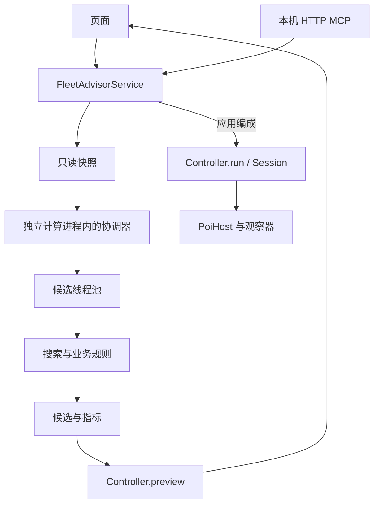

# Fleet Advisor 1.0 架构与维护

舰队参谋是 CommonJS poi 插件。UI、本机 MCP 和推荐 Worker 共用规则与应用服务；游戏操作集中在明确的执行链。React、ReactDOM 和 Electron 由 poi 宿主提供。

## 目录与依赖

```text
index.js                      poi 生命周期与依赖装配
src/
  application/                快照、查询、预览、任务编排
  domain/
    fleet/                    编成计划、装备规则、舰队指标
    combat/                   战斗机制、参考攻击力与标签数据
    routes/                   分岐、路线规划、索敌与制空损耗
    expeditions/              远征条件、收益与配装规则
    quests/                   常驻任务关联与草稿条件核对
  recommendation/             候选、流派、评分与搜索
    loadout/                  通用、对地、对潜与夜战配装
  execution/                  游戏操作、会话、请求及最终核对
  host/                       poi 状态、Electron 与资源适配
  vision/                     图片归一化、观察器与识别 Worker
  infrastructure/
    cache/                    推荐、计算与地图资源缓存
    persistence/              编成方案与远征进度存储
    quests/                   任务列表观察、首次读取协调与内存状态
    workers/                  推荐进程入口、任务队列与候选线程池
  config/                     全局筛选与计算资源设置
  shared/                     名称匹配、错误与纯计算上下文
  bridge/                     HTTP、MCP 协议及工具适配
  ui/
    shell/                    页签、设置和执行反馈
    fleet/                    当前舰队只读页
    workbench/                常规图、远征共用编辑工作台
    expedition/               远征专用视图和显示模型
    maps/                     海图资源、绘制、缩放与加载
    settings/                 设置控件与就近反馈
    models/                   共用只读显示模型
    components/               选择器、标签、拖拽和悬停提示
data/                         规则、敌情、模板与必要图像
tests/                        按职责组织的回归测试
tools/                        test.cjs 及分类维护工具
docs/                         架构和英文 MCP 参考
```

| 层 | 职责 | 依赖边界 |
| --- | --- | --- |
| `index.js` | 生命周期、服务和 Worker 装配 | 不放搜索或战斗公式 |
| `application` | 快照、合同、查询、计划与任务 | 统一承接 UI 和 MCP |
| `domain` | 编成、数值及规则判定 | 不访问 UI、HTTP 或游戏操作 |
| `recommendation` | 组合候选、配装、评分和有界搜索 | 不创建宿主或执行游戏操作 |
| `execution` | 进入画面、调整、等待和核对 | 通过注入的会话访问宿主与观察器 |
| `host` / `vision` | 宿主能力与图像观察 | 不决定推荐策略 |
| `infrastructure` | 文件、缓存和线程生命周期 | 不重定义业务规则 |
| `ui` / `bridge` | 显示与输入适配 | 调用应用服务，共用规则 |

`shared/calculation_cache.js` 只提供可注入的纯计算上下文；磁盘 I/O 位于 `infrastructure/`。`config/` 负责默认值和规范化，不依赖界面或账号存储。

## 查询、推荐与执行



当前舰队读取实际舰队或游戏预设；常规海域和远征维护独立草稿。查询、推荐、装备试配和预览不修改游戏。

常规海域在首次一键补全前只把手动选入舰娘的实际装备复制到草稿，不启动装备推荐或路线／舰队指标评估；换图重新进入该状态。补全成功后换船仍仅重配装备，不重搜舰娘。舰娘选择器默认全部舰种，支持舰种与名称组合筛选，先列第一舰队成员，各组内按等级降序、实例 ID 升序排列。自动推荐筛选条件在选择器中只显示原因，不隐藏或禁止手动选入；远征、入渠和同舰重复等实际不可用状态仍禁选。

常规海域的手动选择保留舰娘及 `keep` 指定的装备，但不锁定舰位：UI 通过 `heldSlots[].holdPosition=false` 允许选船、特殊攻击安排及最终排序移动整舰，合并结果也遵循推荐舰序，并按舰娘 ID 恢复手动装备。应用服务分别核对成员、可选的位置约束和装备归属。MCP 的 `holdPosition` 默认 `true`，省略时兼容原有固定舰位语义；远征工作台仍保留原有固定旗舰与舰位行为。

`domain/fleet/fleet_plan.js` 的 `createFleetPlanner` 生成并验证计划，供推荐器、带路与 `Controller.preview` 复用。`organize_planner.js` 解析编成合法性。`Controller.run` 进入执行链，使用同一计划、实例约束、实时状态核对、执行锁和幂等任务。

### 截图驱动的自动操作

自动编成和换装采用游戏画面识别、被动请求监听与 poi 实时数据三方核对。`PoiHost` 连接唯一的游戏 `webContents`，通过 CDP 获取完整视口的无损 PNG，并向游戏窗口发送鼠标事件，不操作桌面鼠标。识别在独立 Worker 中完成；执行器读取结构化结果决定下一步，不直接调用游戏的编成或换装接口。

```text
预览与执行计划
  → 当前游戏状态及操作前提核对
  → 截图识别页面、列表、目标行或确认按钮
  → 再次核对实例、装备来源和游戏状态
  → 向已确认的游戏控件发送鼠标事件
  → 被动核对实际发出的变更请求
  → 等待 poi 中相关舰队、舰娘和装备状态符合预期
  → 截图确认界面就绪，再进入下一步
```

| 组件 | 职责与核对范围 |
| --- | --- |
| `execution/session.js` | 操作顺序、取消与期限、画面时效、稳定性要求、前后状态检查及运行指标 |
| `host/poi_host.js`、`execution/request_monitor.js` | 游戏窗口生命周期、截图与输入；精确核对已发出请求的端点和参数，不拦截或修改流量 |
| `vision/worker_observer.js`、`vision/worker.js` | PNG 解码、尺寸归一化、观察项调度及受控的单帧像素复用 |
| `vision/observers.js`、`vision/equipment_icons.js` | 页面、控件、列表和装备类别识别；保留匹配门槛与歧义检查 |
| `execution/organize.js`、`execution/equipment.js` | 按计划换船和换装，核对变更后的完整状态；最终重新检查目标顺序与装备实例 |

画面核对负责确认控件和页面是否就绪，请求监听确认本次输入实际触发的操作，poi 数据核对确认最终变更内容。执行器当前监听请求发出，不把请求通知当作服务器响应成功；操作完成仍以实时状态及后续画面检查为准。发生未知画面、歧义、状态偏离或超时即停止后续操作，已提交的变更不自动重复或回滚。

截图数量随实际步骤和动画就绪时间变化。导航、列表建立及分类菜单通常需要两张新截图确认稳定；已有稳定列表可在受控时效内复用，选行后和借装弹窗仍重新检查。优化集中于批量观察、单帧解码复用、图标统计复用及首次截图时机调度，不通过降低识别门槛或跳过操作前后核对提速。截图仅用于当前识别，不写入运行日志；离线耗时、只读加载验证与真实编成验收分别报告。

编成执行从第一位顺序核对目标实例，已正确的位置不打开选择器；其余位置通过原版选舰与确认按钮替换。选择本队其他位置的舰娘会原地交换，同时修正的位置不再重复操作。目标舰娘全部就位后才从末尾逐个移除多余僚舰；仅保留一舰时使用原有解除随伴舰按钮。单舰移除通过选舰面板的「はずす」按钮，两帧确认目标舰队页签、筛选栏与完整按钮参考后点击，不依赖排序或页码。每次请求精确核对目标舰队、位置和实例，并等待所有舰队状态与预期完全一致，未确认不重试。跨舰队替换遵循游戏原生互换，旧舰会进入来源舰队的原位置；空位追加则使来源舰队前移，均按真实结果核对。不会为了缩编或换旗舰先拆掉已正确的僚舰，也不改变目标舰序与装备实例。

`domain/fleet/equipment_changes.js` 比较逐槽替换／单槽卸下和全部卸装重建的交互与核对成本。可用装备直接替换指定槽，优先利用替换释放出的同舰实例；同舰互换或删除装备时，模拟单槽卸下引起的后续槽位前移，再推导下一步。成本相同优先保留已正确的装备；大部分装备都要移除、全卸确实更省操作时仍保留全卸路径。此为有界启发式规划，不保证全局最少点击。增设先释放需要转入普通槽的实例，逐舰完成，借装来源位置始终根据演进后的状态重建。实例分配、改修熟练度、舰位和目标配装均不改变。

普通槽卸下仍通过游戏 UI，先确认完整改装基础画面、目标舰队页签与指定行的原版叉号，才允许点击。普通槽叉号位于归一化横坐标 824 附近，各行按首行 271、行距 47 定位；增设卸下按钮位于另一列，不能作为普通槽依据。叉号只在该槽限定区域内匹配，保留横向 ±3、纵向 ±12 像素的范围及 0.75 的 IoU 门槛，不能跨行或整屏查找。回归使用真实三槽、四槽、五槽脱敏画面，并覆盖缩放、遮挡、错误舰队、旧列位置和隐藏行。提交后核对完整槽位压缩结果及增设，来源、其他舰娘或预期状态发生变化即停止，不重复提交。`tools/vision/build-equipment-remove.py` 从项目外原图集生成必要识别掩码。

请求监测保持被动。取消只停止后续步骤，已发出的游戏请求不能被吞掉、伪造或改写。执行期间保留 UI 布局，只更新进度、计时和停止入口，结束后统一刷新派生信息。

导航除母港、编成和改装主页外，还可识别左上角原版页面圆钮的固定边框，联合检查亮色内缘、深色分隔带与金色外圈，不以旋转中的页面文字为正向匹配条件。母港画面优先识别，另外使用可旋转的母港图案负例排除隐藏 UI 按钮。两帧一致后仅点击返回一次；随后必须确认母港，未确认则停止，不重复点击同一位置。变暗或被遮挡的边框不能授权点击，失败诊断区分边框缺失和母港按钮排除。识别为按钮不代表已实机验证所有页面的导航行为。

边框允许同一组圆弧整体偏移最多 1 个归一化像素，亮度、内外对比及金色样本数量阈值不变；失败时记录最佳位置及测得数值。导航确认保留 6 秒识别预算，另按实际截图耗时补偿最多 12 秒，总期限最多 18 秒，不改变两帧稳定确认、取消与全局期限；其他选装观察默认不增加该余量。

执行器将同一装备列表的模式、页码、分类和目标行检查合并为一次 `batch` 观察；识别线程只解码和归一化一次截图，再在同一帧执行各项检查。导航、列表建立和分类菜单要求两张连续一致的有效画面。列表已经稳定后，选行前完整核对模式、分类、页码和装备图标：若最后一帧不超过 500 毫秒且其间没有任何输入，直接对该帧执行新的观察；否则重新截图。复用失败后的轮询必须重新截图，两帧稳定确认也不能将同一帧重复计数。任何输入、取消或停止立即释放帧；每次观察仍执行前后完整状态检查，库存分配不缓存。选行后按钮就绪和借装确认使用新截图，后者同时核对完整弹窗边框和确认／取消按钮，打开弹窗后不额外固定等待 100 毫秒。提交前完整检查游戏状态与来源船，提交后核对双方状态及界面就绪，失败不重复提交。

识别线程只保留最新一张截图的归一化像素（1200×720 RGBA，约 3.30 MiB），不保留高 DPI 原图或识别结果。`Session` 仍以截图开始时间、500 毫秒上限和输入序号决定是否允许复用；`WorkerObserver` 仅对明确授权且 PNG Buffer 引用一致的帧发送内部编号，避免再次传输、解码与缩放。新截图即使字节相同也重新处理，缓存编号缺失或不符即拒绝；每个识别项仍按原参数和阈值运行。输入、停止、识别异常、重新初始化和销毁释放该帧，新的稳定性检查仍使用两张独立截图。`WorkerObserver.frameMetrics` 仅记录解码／归一化／复用次数、处理耗时和单帧保留字节数，不含画面或账号数据。

`vision/equipment_icons.js` 在每次图标匹配内共享灰度窗口的前缀统计和同尺寸模板的窗口下界，局部工作区随调用结束释放，不按图片内容缓存识别结果。快速统计包含覆盖前缀求和、矩形差分与原算法逐像素求和的保守浮点误差余量，仅跳过确定不能通过方差条件或不能刷新当前最高分的位置；可能影响最高分的候选仍按原逐行顺序计算点积和精确范数。所有图标、四档模板缩放及候选位置保留，最终分数门槛 0.6、类别差距 0.04、近乎完全匹配门槛 0.98 和同分顺序均不改变。独立暴力扫描回归逐类比较完整分数，不只核对最终类别。

装备来源模式可由列表标题或右侧模式切换按钮独立确认。游戏的分类／详情控件可能遮住来源标题，此时完整匹配“ストック装備”按钮确认当前为其他舰娘装备列表，匹配“他艦娘装備中”按钮确认库存列表。两种按钮同时比较匹配误差与差距；排序标题仍须通过，包含库存筛选状态下的校准样本。两项指示冲突时拒绝操作，不根据目标计划推测模式，也不放宽原有匹配阈值。回归素材只保留这三个控件区域。

编成选行直接核对刚取得且中间没有输入的稳定列表结果，不再另拍一次相同排序、筛选和页码；点击后的确认卡片仍须重新识别。进入换装页时，导航从同一组已确认的基础页面截图返回舰队编号，缺少编号时才独立读取页签；编号不符仍先切换并确认。已确认编成主页后，直接点击侧边改装按钮 `(30,390)`，再确认改装主页，不经母港；坐标对应游戏 `SideMenu` 的改装按钮（`port_sidemenu` 9／10，位置 `(0,356)`、尺寸 `63×70`）。其他入口保留母港导航。每次装备变更后的界面就绪检查继续保留。

选舰与装备列表共用 `execution/picker_navigation.js`：目标页可见时直点数字，向后比较邻近页与回首页的成本。每次导航先确认一次向前按钮确实为 `+5`，然后计算剩余跳转次数，每批最多连续点击 4 次固定位置的向前按钮，批次结束才重新读取页码及可见窗口；数字页按钮、回首页仍单独确认。每次输入保留取消与完整状态检查、点击间隔。批次少翻且实际页码仍以 `+5` 前进时，从实际页码继续，余下步骤逐次确认，不重放整批；错误跳转、重复窗口或整批无进展则停止。翻页预算按当前筛选后的实际页数计算，不沿用整份装备库存或固定 40／60 次上限。具体装备实例按实时列表重新定位；保留当前分类与切换兼容分类的两次点击成本一起比较，目标已在当前页时不切分类，成本相同优先保留当前分类，再比较列表长度。图像方案仅考虑已有校准模板支持的分类，仍使用实时库存投影定位实例，不读取控件模型或伪造真实列表。列表及分类可读而模式标题不可读时，直接进入一次分类复位，不先等满六秒；复位菜单打不开或复位后仍不可读即停止。借装仍独立核对来源，选行前仍检查模式、分类、页码和装备图标。

`Session` 在观察和输入边界完整核对宿主及游戏状态；内部定时等待和 Promise 记账只检查取消、期限和由生命周期事件维护的连接失效标记，避免重复跨进程发现宿主及全量扫描。`equipment_guard.js` 每次完整核对仅取一次当前状态，仍检查全部库存实例及改修、舰队、名册和非本次变动舰娘的配装，支持对象原地变化。操作前提、借装来源、被动请求字段与操作后状态、最终状态的核对不变。保留连续输入所需间隔，不增加重复提交或盲目重试。

编成与换装中，紧接着有画面／请求／状态核对的输入使用 `settleMs:0`，直接进入核对流程。图像方案复用 40 毫秒稳定确认下限，截图和识别已满足此间隔时不再叠加稳定等待，快速截图只补足不足部分。未就绪时保留 100–240 毫秒退避，避免更早重拍昂贵截图导致额外采集；控件的短重试节奏不直接套用到图像方案。连续翻页和其他默认输入缓冲为 40 毫秒，玩家设置的每步额外等待继续叠加。分类菜单仍通过两张独立新图的识别结果一致来确认，不能凭等待时间判断就绪；逐舰顺序、识别阈值、阶段期限、取消及输入前后的核对不变。慢动画可能增加早期截图次数，离线定时等待的减少不等于实机耗时收益。

首次截图调度使用 `execution/transition_timing.js` 的运行期时机记录：按输入位置、输入类型、请求端点与观察结构分组，连续两次自然探测确有过早截图后，才参考最近两次已验证画面的截图起点，最多等待到输入完成后 400 毫秒，已经耗在请求／状态确认上的时间直接扣除。每第三次已学习的检查立即探测；已学习界面变快时清除全部旧记录，预测后仍不可读则丢弃该组记录，继续原有新帧轮询。延后后的成功结果不反过来训练自身等待时间，极慢或失败样本不用于预测。只有首张新截图受调度，不延长原有期限、不改变两帧稳定确认或 500 毫秒复用时效，也不凭预测点击。最多保留 64 组、每组两个时间值，停止即清空，不保存图片或识别结果。`delayedProbes` 和 `probeWaitMs` 记录延后次数与等待耗时，后者已包含在 `waitMs` 中。此优化主要降低无效截图负载，不保证每个场景都缩短总耗时；突然变快时最多两次使用旧时机，随后即时探测刷新。

执行结果的 `metrics` 包含截图与识别次数、`captureMs`、`observeMs`，以及完整检查次数 `checks`、`hostCheckMs`、`validationMs`、`inputMs`、`waitMs` 和 `observationsByKind`。`inputMs` 包含输入及被动等待请求通知；`waitMs` 是实际定时等待。各计时可能包含嵌套开销，不应直接相加作为总时间；总耗时以 `totalMs` 为准。离线模拟只衡量执行步骤和检查开销，不代表实机网络、动画或 Electron 截图耗时。

截图使用完整视口、无损 PNG 的 `optimizeForSpeed` 编码选项，避免改变分辨率、截取范围和识别阈值；旧协议明确拒绝该参数时，仅回退一次并在当前宿主记住能力，截图超时不触发重试。`reusedFrames` 统计省去的重复截图。`captureBreakdown` 按运行累计宿主检查、截图命令返回、Base64 转换耗时，并记录最大命令耗时及事件循环延迟；超过 1 秒的截图只保留最近 4 条时间、尺寸、字节数和观察类型摘要，超时诊断同时附带这些数据。不保存截图或账号数据。截图命令时间包含 Chromium 合成、PNG 编码和跨进程返回，不能仅凭该数值断定 GPU 或网络故障；事件循环延迟高则表明插件线程调度受阻。实际数秒卡顿未重现时，不将常规编码收益当作根因已经消除。

观察超时使用 `OBSERVATION_TIMEOUT`，错误堆栈和 MCP 任务错误附带有界的结构化诊断：观察次数、阶段耗时、截图／识别耗时，以及最近两次识别摘要。`batch` 按子项列出结果；选装前的最终核对另外记录舰娘、槽位、装备实例、期望模式／分类／页码／行号，并区分不可读与期望值不符。装备图标保留期望与识别到的类别。诊断仅允许必要识别字段，不保存截图、账号快照或请求凭据，不增加截图、输入、重试，也不放宽识别阈值。

`config/experimental_settings.js` 管理实验权限，`automaticOperations` 默认关闭，旧配置缺失该字段时同样关闭。权限与 MCP 总开关分别持久化。关闭时工作台隐藏整个应用区域，服务同时在面板执行、MCP 新计划执行及异步任务真正启动前校验权限；关闭开关会请求停止当前任务的后续步骤，执行期间保留停止入口。查询、推荐、评价、预览与历史任务查询不受影响，MCP 不提供开启实验权限的工具。恢复推荐默认值不改变这类执行权限。

### 控件驱动的自动操作

后台调试设置 `recognitionMode` 支持 `controls`（默认，控件优先、图像兜底）与 `image`（仅图像识别）。玩家设置页仅提供自动操作开关与额外等待，不显示识别方式；缺失或无效的设置采用 `controls`，已有后台调试选择保留。面板与 MCP 在任务启动时固定首选方式；控件识别失败时，本轮允许单向切换图像一次，不改写玩家设置。切换时销毁旧观察器，控件观察器在每轮启动时绑定当前宿主。自动操作权限、预览、幂等、执行锁、停止及编成／换装规划共用原有应用服务，不存在第二套游戏操作接口。

`host/control_reader.js` 由 `PoiHost.readControls()` 在唯一的游戏 `WebFrameMain` 主世界中执行，只读取当前 PIXI 渲染树的数据字段，不调用游戏处理函数、模型方法或变更接口。通过渲染器对应的 Canvas 查找唯一根节点，再识别母港、编成、改装、列表、装备详情、分类菜单及借装弹窗。读取链核对双向父子关系、可见性、透明度、输入开关和原生事件绑定，以实际变换矩阵求可点击区域与中心。预先构造但未挂载的面板、隐藏行、灰色按钮、透明全屏输入遮罩与未知弹窗不能授权点击；母港的隐藏 UI 圆钮不会被当作返回按钮。宿主同时固定游戏帧标识及文档时源，帧重载或更换即停止。

`execution/control_observer.js` 将只读结果转换为与图像方案相同的观察协议。`Session` 保留原有稳定性、期限、取消、状态检查与每步额外等待；控件方式使用两次新的控件读取确认导航和列表，不调用截图或图片识别 Worker，也不将同一结果冒充两次读取。`metrics.controlReads` 记录观察及输入前复核次数，图像的 `captures`、`captureMs` 在此方式下为零。输入前再次读取当前显示层，只对唯一、可用且与预期操作匹配的原生控件发送 CDP 鼠标事件；实例或状态变化时停止。控件不可读可进入受控的图像接续，切换进度明确显示。

控件方式的稳定确认间隔为 40 毫秒，未就绪时按 40–120 毫秒退避，默认输入缓冲为 40 毫秒；图像方式复用同样的稳定确认下限与输入缓冲，但保留适合截图成本的原有未就绪退避。玩家设置的额外等待照常叠加，两次新读取、输入前复核、请求匹配及提交后的完整状态核对不变。分类选择使用当前真实列表（含子分类）的实例顺序计算保留分类的翻页成本，与其他兼容分类的切换成本比较；同成本优先保留当前分类。切换后的列表重新读取，库存投影不授权选行，不调整逐舰逐槽的执行顺序。

控件导航在原有页面确认之外，另核对目标按钮可用且坐标连续两次稳定，再执行输入前复核；页面名称出现不等于按钮已经就绪。

分类选项的点击点还须位于所有祖先裁剪区域内；矩形动画遮罩按实际变换矩阵核对，未知遮罩不授权分类输入。分类菜单展开时，指定分类尚被遮挡则继续等待，不能因顶端“全装備”已露出就提前点击底部分类或退回其他分类。

编成详情核对目标舰队、舰位与舰娘实例；装备选择核对舰娘、普通／增设槽、实际实例、来源舰、分类及页码。控件方式直接使用游戏当前筛选列表的实例顺序定位装备，因此保留子分类时也不依赖本地重建顺序；每页显示的实例仍须与原生列表模型一致，目标行另核对库存类型、来源及可用状态。借装确认只允许当前最上层的原生确认按钮，并再次核对来源槽位实例。普通卸装、增设卸装、全卸、解除随伴舰及单舰移除仍使用现有计划、请求参数和完整状态守卫，提交后等待 poi 数据收敛，最终核对全队及来源舰。游戏私有字段布局不符合已知结构时，可在已核对的操作边界切换到图像识别；无法确认安全接续则停止。

`execution/recognition_fallback.js` 只接受控件读取不可用、控件观察超时及控件列表模式不可读。切换前继续执行原阶段的完整状态守卫，并要求没有未核对的提交、待匹配请求或活动输入。`Session.pendingMutation` 从提交前保持到 poi 状态完全收敛、守卫恢复全量核对后，才由 `confirmMutation()` 清除；连接变化、停止、期限到达、库存变化、来源实例不符、歧义及不明提交均不授权回退。

接续保留同一宿主、会话、取消信号、总期限、输入序号与累计指标，仅替换观察器，释放原帧和时机记录。图像观察用两张新图识别基础页面、可用的返回母港边框，或完整借装确认窗；借装只点已确认的取消按钮，不点提交按钮。恢复到母港后，以原固定实例方案重新进入失败的编成／换装阶段，已有正确舰位与装备由原规划器跳过，不复用控件的筛选列表、行号或坐标；首次普通装备列表通过已有图像模板复位到“全装備”，避免游戏保留的子分类改变实例顺序。之前已验证的变更计数保留；剩余阶段一直使用图像识别，失败不再重试。指标额外记录首选方式、最终方式、一次切换摘要及已核对变更数，不保存图片或账号数据。

控件结构回归使用人工构造的数据与场景树，不提交真实账号快照或完整游戏脚本。实机验证的输入、请求成功与恢复核对记录留在项目外；不得将只读控件探测或模拟测试称作真实编成验收。

六舰整套编成与换装的性能基线（2026-10-29，`6abeefe`）：同一起始状态、同一套 22 个普通槽与 5 个增设槽配装（含 15 次借装），额外等待为 0 秒，经正式 MCP 入口执行，图像识别耗时 186.2 秒、截图 491 次，控件识别耗时 123.1 秒、截图 0 次，耗时降低 33.9%；两轮均为 226 次界面操作，操作顺序一致。收益主要来自省去截图和图片处理，剩余等待集中在游戏响应、poi 状态同步及界面稳定确认。此为单次配对实测，不代表固定加速比例；测试后舰位与全部受影响装备均恢复，三个页面草稿未变。

控件调度与真实列表路径优化后，同一起点复测耗时 107.4 秒，较控件基线降低 12.7%，仍为 226 次操作、35 次变更和 0 次截图。分类菜单由 11 次降为 9 次，翻页由 59 次增至 63 次，总点击数未减少；逐舰逐槽顺序及核对机制保留，并补充分类动画裁剪和导航按钮就绪检查。网络与页面等待有波动，不能将全部耗时差归因于调度调整。

控件转图像兜底实测（2026-10-29）：同一套六舰实例方案，额外等待 0.3 秒，在借装确认窗提交前注入一次控件读取故障，自动取消弹窗并接续剩余换装。总耗时 211.5 秒、240 次操作、357 次截图，交接约 3.6 秒；35 次实际变更与预览一致，无重复提交，切换前后均保留 300 毫秒额外等待。准备和恢复不计入上述耗时；测试后四队舰位、全部受影响装备及设置均恢复，三个页面草稿未变，临时故障钩子已移除。

### 默认筛选与推荐范围

出击与远征分别保存筛选条件。出击默认使用 30 级以上、已改造且可用的舰娘，并排除未锁定、大破和疲劳等状态；远征默认不限等级和改造，但排除远征中、入渠中、未锁定和第一舰队的舰娘。明确手动选入的舰娘可覆盖自动偏好，实际可用性和装备合法性仍会核对。

常规推荐一次只搜索一个阶段的全部预设，不设置阶段内推荐路线数量上限；旧 `maxRoutes` 配置不再生效。默认阶段读取 `info.maps.api_gauge_num`，缺失时按第一阶段规划，不推断已解锁。显式 `phase` 或 `routeKey` 可以选择其他阶段，同步与并行推荐遵循相同规则。路线面板保留完整预设目录，当前阶段默认展开，其他阶段折叠；展开不发起搜索，选中其他阶段的路线后才计算该阶段全部预设。工作台最多保留 8 份近期结果，以阶段、手动约束、筛选条件和快照分别核对，换图或重新配装后释放；过期异步结果不能覆盖新草稿。常规与远征线程数独立设置，自动模式按本机可用资源选择。

出击设置 `normal.allowEquipmentBorrowing` 默认 `true`。关闭时，`recommendation/loadout/equipment_borrowing.js` 按候选成员筛选快照装备库存，只保留仓库与本次编成舰娘的普通槽、增设槽装备；远征和基地航空队等装备不可用限制仍有效。队内可互换，换舰后重新计算范围，来自被替换舰的自动配装清空后重配，手动保留的冲突装备报错并保留草稿。选船、固定舰队调装、并行任务和最终候选核对共用此策略；单舰提速潜力等前置可行性估计可以乐观评估，但实际完整候选必须通过库存核对。每份快照库存最多缓存 128 组舰队库存视图，不跨快照复用所有权。UI 与 MCP 经应用服务注入保存的设置，客户端参数不能覆盖；完整推荐缓存包含设置和快照，源码更新也会使旧缓存失效。远征配装不受出击借用开关影响。

舰船可操作性与装备可借用性分开判断：`availableShip` 继续限制远征、入渠中的目标舰；`availableEquipmentSource` 允许从入渠舰取走装备，禁止从远征舰借用。推荐库存、MCP 查询、预览和执行前来源核对遵守同一规则，取装后仍核对来源舰的槽位压缩与最终状态。未来编成规划保留原始远征装备锁，不把入渠装备锁死。规则参考 [Wiki 新米提督手引：入渠中的装备转移](https://wikiwiki.jp/kancolle/新米提督の手引き)。

### 运行路径

插件数据保存在 `~/.poi-plugin-fleet-advisor/`，运行日志位于安装目录的 `logs/`。首次查看海域地图需要已有图片缓存或可用网络；资源加载失败不会清空草稿。

## 推荐模块

所选路线的最终 Boss 到达率使用 `bossArrivalChance`：能动分歧遵循该路线明确指定的出口，其他随机出口仍遍历完整后续路径，包含能抵达 Boss 的绕行分支。未指定、冲突或非法的手动出口不自动择优；阶段锁、索敌上下界、未知条件和真实偏航保持原判定。不改变无路线约束的全图查询结果，也不改写推荐草稿。

公共入口为 `src/recommendation/index.js`。

常规搜索始终按路线组织，`scoreRoute` 为每套编成生成一份战斗／航空／对地／对潜及资源读数，不提供全局目标切换，也不返回平行偏好标签。省略路线时按当前或指定阶段的推荐目录运行，指定 `routeKey` 时只计算所选流派；制空目标仍可独立指定。候选采样面向筛选后的完整舰娘目录；按所选预设的编成约束生成结构，仍需实际带路与最终配装核对。

编成模板用于生成候选，不按“符合示例舰种组合”额外加分；预设自身声明的舰种要求仍是该方案的边界，不等于游戏全图的硬性限制。真实带路、装备合法性、制空、索敌及攻略可战状态仍核对。特殊攻击候选在不同攻击核心之间轮流分配原有的 64 组预算，每核心最多 8 组，避免单个核心耗尽名额。提速调装仍最多检查 48 组舰娘组合，同时保留裸舰战力、对潜和航空潜力的候选，之后才实际预留推进装备并核对路线。

常规图的合流路线由 `optionPaths` 统一读取普通 `paths` 和提速策略 `strategy.paths`；`fleetPaths` 按当前编成、阶段和逐路径历史过滤分支，名称、高亮及当前命中说明共用结果。未知条件保留可能分支，整组受阻时清空高亮并保留完整条件用于诊断，空草稿仍预览完整目录。`displayPathLabel` 优先于策略中的静态摘要，`displayPaths` 不覆盖原始路径；相同前后段的两个走法可使用可选绕行节点，其他组合只做不会引入额外路径的合并。带路说明按分支依赖顺序排列，所有上游节点先于合流后的节点。推荐、手动换船和 MCP 路线评估共用这些纯展示投影，不改变带路规则、搜索约束或推荐评分。

`data/normal_route_guides.json` 是常规海域推荐预设的唯一目录，覆盖 37 张地图与各血条阶段，也保留部分解锁目标。预设来自舰种结构、逐点带路与沿途敌情分析，并用 Wiki 检查实际作战取舍；不是胜率最优证明。名称优先区分走法，同路再以大致流派区分，必要时用舰种数量消重，不限制汉字字数。方向前缀仅在同一海域、同一阶段的备选确有方向差异时使用；同路方案省略方向，同方向绕行用“最短／绕路”等区分，共同的随机分支也不重复写入每个名称。`fleetRequirement` 表示该预设的编成约束，`templates` 提供搜索种子，`strategy` 表示速力、电探等必须实际配出的要求。`guide:<id>` 是不透明的预设标识，不从名字解析规则。同一物理路线可有多个不同编成预设；明确指定的物理路径仍可独立查询，不受预设的舰种偏好限制，也不加入默认推荐列表。权威游戏带路条件始终来自 `data/normal_routes/`，预设不得覆盖它。

每个预设记录完整可行合流分支，并配有独立的合成带路样例回归。1-4 空母方案使用潜水母舰、三艘空母系及两艘实际可先制雷击舰；甲标的实例不能重复分配。提速方案支持一至六舰，只有实际推进装备、舰种与所选路径都通过核对才输出；不会把五舰最速方案降为普通高速。UI 路线选择使用锚定于控件下方的弹出面板，名称与路线字母分层显示，多阶段按阶段分组并优先展示当前阶段；可取消预选，支持键盘、外部点击关闭和隐藏页清理。


| 模块 | 内容 |
| --- | --- |
| `context.js` | 可用名册、手动与排除条件、舰娘家族及装备保留 |
| `scoring.js` | 舰体、开幕攻击、空优、昼夜战及特殊攻击评分 |
| `fitting.js` | 制空、提速、索敌与战斗配装候选调整 |
| `strategies.js` | 攻略流派、舰种模板、种子及舰位约束 |
| `normal.js` | 常规候选、批量评估、短名单与最终筛选 |
| `refinement.js` | 同舰种优先的逐舰位升级候选、独立收益合并与家族去重 |
| `route_economy.js` | 所选路线难度分档、逐舰边际收益与轻量化候选 |
| `expedition.js` | 成功／大成功目标、候选、配装与净收益比较 |
| `expedition_candidates.js` | 属性型远征失败后的裸装与可调装候选排名 |
| `loadout/` | 通用及专门装备策略 |

依赖方向为 `context → scoring → fitting → strategies → normal`，后者使用前者。远征主要复用上下文和远征规则。对潜公式在 `domain/combat/asw_combat.js`，实际试配在 `loadout/asw_fitting.js`，规则不反向依赖搜索。

`asw_capability.js` 统一普通对潜的舰种／装备资格，先制判定另外使用 `opening_asw.js`；推荐与攻击力说明共用这些规则。飞机按满补给、普通槽正搭载判断，水听、水侦或水战不单独开启航空对潜，轻空母的旋翼机先制与普通攻击资格分开核对。纯对潜的航空舰先配出有效攻击，再比较先制与整套攻击力；最终试配每步保留八个候选，按真实库存、借装权限和手动锁定分配装备。评分计入普通对潜，纯对潜在覆盖达标后以先制能力和有界的整套攻击力继续比较，不给无水上目标的开幕航空火力加分；混合路线仍保留护航预算、炮击、制空、索敌及带路复核。

`loadout/combat_value.js` 为普通配装与评分共用战斗属性。属性投影先从实际面板扣除旧装备白字和已知蓝字，再加入新组合的白字与蓝字；火力、雷装和对空使用与机制标签相同的 `equipment_bonuses` 数据。蓝字资料不完整时保留带原因的属性估计，不虚构未知加成，也不因此禁用手动装备。护甲随换装更新；仅在路线存在航空威胁时评价装备新增的对空收益。

初配按舰娘与装备效果比较主炮，不再仅凭基础属性同分后的实例编号决定；初配的单件蓝字偏好只用于提出种子，完整的组合蓝字在候选评分中计算。辅助槽优先兼顾首部电探、命中、防空和其他可用用途。已有电探后，额外电探的命中与索敌排序权重下降；无索敌门槛时只保留很小的通用侦察权重。此为推荐策略，游戏中电探属性仍正常叠加；没有电探数量硬上限，索敌与带路调装仍可按需要追加。手动装备、手动空槽、库存唯一实例和槽位资格优先于这些偏好。

对空 CI 以 `anti_air_cutin.fleetAntiAir` 的实际类型、优先级和互斥发动概率评价全队覆盖，不累加各舰的独立发动率。评分采用有界的固定击坠／倍率收益代理并按所选路线的航空威胁加权；它不是预期击落架数或胜率，未知效果不捏造数值。该收益只参与战力排序，不替代制空、索敌或到达条件。装备效果、逐舰属性和 CI 规则在不可变搜索作用域内复用，初配排序按角色复用；实际库存分配、手动保留和最终核对每次照常进行，不新增全队装备穷举。

`loadout/auxiliary_refinement.js` 在最终入选配装中有限回查普通槽与增设槽，比较电探、机枪、装甲、见张员及高射装置的替换和跨槽移动。每种用途保留两个装备效果、每舰保留两个整套候选，全队最多六组交给原有候选评价器，不重启选船、航空／对地调装或新的线程批次。提案保留主炮、飞机、提速、对潜、对地及手动槽位，按真实实例检查库存和借装资格，并保护已有对空／夜战机制、固定条件发动率与特殊攻击所需电探。最终仍按完整收益排序，复核带路、索敌、沿途制空、对潜和执行预览；整队推荐保持原到达概率，换装推荐仅允许到达概率不降低。它是有界改进，不保证辅助装备全局最优。

带路核对与战斗评分通过 `fleet_metrics.projectShip` 共享不可变的舰娘投影；投影复制本次槽位数组，避免初配继续填装时污染已计算的装备列表。战斗评分每舰只读取一次整套属性，后续火力、雷装、装甲、对空与夜战共用该读数。`combat.panels.read/build`、`loadout.rank.hit/build`、`loadout.auxiliary.screened/proposed/accepted` 可区分属性读取、实际重建、排序复用与有限回查；缓存不跨可变的实时快照复用。

新增机制先区分数值规则与搜索策略。推荐必须尊重手动舰位和装备；特殊攻击重排仅在许可范围内进行，最终核对路线、索敌、制空及可用性。有界搜索失败不证明玩家库存绝无方案。

搜索前按所选路线的必要舰数条件缩小编成规模：保留原规则顺序与 `all/any/not`，舰种、装备、速力、索敌和历史经过点仍按未知处理，不能用攻略示例模板限制普通路线。舰种数量只用于证明“总舰数不足以容纳最低要求”，不据此认定舰种已满足。仅将这些尺寸传给原有候选与分片枚举，保留每个可用尺寸的采样数、排序和配装机会；未受限的图继续原来的搜索。手动舰队与所有可行尺寸冲突时保留原范围，以便给出受阻说明。

1-1 的自动搜索先采用已有攻略偏好的一至两舰规模，仍比较不同舰种、开幕雷击／航空与实际配装。手动指定超过两舰或指定攻略偏好排除的舰种时保持原范围；没有找到符合小编成偏好的初配候选时回退完整搜索。已有装备与舰位保留规则不变。`search.size.allowed.N`、`candidate.sizeRejected`、`search.compactFallback` 记录启用的尺寸、提前跳过候选与回退次数，不保存舰娘实例。

常规搜索的带路核对通过 `evaluateSearchRoute` 使用最终装备状态投影：仅在不可变快照作用域内、舰娘与所有槽位均指定具体实例时，复用编成校验和装备可用性／适配检查，以唯一实例集合代替通用名称匹配与分配，省去中间搬移步骤。部分槽位、名称或保留原装请求回退完整预览。入选方案仍须经过 `FleetPlanner.preview` 的完整操作计划验证；公共带路查询与搜索使用独立缓存，搜索结果不能代替执行预览。

同一次带路核对只构建一份舰队投影，再交给制空、索敌、速力和先制对潜计算。速力和先制对潜与已有逐舰索敌缓存一样，以舰娘实例及前后完整槽位为键，在不可变搜索作用域内复用；换舰、换装或调整增设不会误用旧读数。缓存有界、不同快照隔离，退出搜索后实时查询重新计算；各项指标与推荐评分保持完整，不省略先制对潜等非带路指标。

航空调装采用航母优先的逐槽搜索：初装舰战从最小的正搭载槽开始，补制空时先升级已有舰战，再使用较小的辅助／攻击槽，达标后优先将较大的舰战槽释放给攻击机。高对空攻击机先按制空增量与攻击损失排序，找到通过沿途核对的最佳单槽替换后停止；保留小槽保护、自动喷气 CI 条件、手动装备与最终索敌／带路核对。此顺序是推荐策略，不代表游戏强制配装规则，也不声称枚举了全局最优组合。

常规航母编队不搜索水战与航母攻击槽的交叉替换，水面舰优先保留炮击、雷达等用途；无航母或仅一艘轻空母时正常考虑水战，并保留小船流为制空腾出必要槽位的能力。其他编队只有航母舰战及高对空攻击机调装后仍未达标，才单向增加水战兜底；不会为可选空确升级启用这个兜底，也不会为增加航母攻击槽而主动加入水战。已有手动水战不会被此偏好删除。水爆仍可因攻击、对地或观测价值参加整套方案比较，但不会作为补制空的战斗机候选。空确升级先检查乐观出击上界：忽略库存竞争与损耗、允许同机种升级，仅牺牲原有可承受范围内的一个非核心攻击槽；即使该上界都不足时才跳过后续升级。水战小船流不使用此航母上界裁剪。

`loadout/aircraft_survival.js` 将沿途攻击机残机边界纳入最终评分，复用 `route_air` 的同一份逐槽模拟，不重复模拟。普通飞机详细结果包含末尾节点迎击后的残机；末尾损耗不改变该点战前制空或制空门槛判断。已知损耗按保守下限折减开幕收益，水爆单独支撑观测时另计观测丢失风险；已有正搭载水侦则不加这部分风险。敌方特殊对空迎击缺乏定量资料时保留未知状态，仅增加小攻击槽的定性风险权重，不生成虚假的发动率或击坠概率。风险权重及 0.35 的候选门槛是排序启发式，不是游戏公式。

高风险水爆配装会额外比较至多一套全队水侦替换方案，并与原有航战航空方案共用有界候选评估。替换检查真实库存、普通槽权限、借装资格和手动保留，制空、索敌、到达率及最后预览照常核对。舰战、水侦不按攻击机迎击折减，喷式强袭沿用专门评分；不带攻击机的编成不新增航空模拟。

同槽制空贡献仍由 `fleet_metrics.airPower` 逐槽公式提供，装备蓝字对空不加入制空值。`route_air.airContributionKey` 与损耗模拟共用机种、搭载区间、有效对空、熟练度以及喷气机种／钢材等输入，未知数据不归组。`air_fitting` 在当前配装不变时复用数值等价替换的可行性结果；接受任意换装后清空局部表。不同名称的攻击力、索敌、装备加成、适装、所有权及库存实例仍分别评价和分配，不按显示制空整数粗略合并装备。完整推荐缓存通过源码摘要自然失效。

详细性能日志中的 `air.equivalent.hit` 记录这层等价试配复用，`air.supremacy.ceilingReject` 记录空确乐观上界排除，`air.waterFallback` 记录常规航母方案无法达标而进入水战兜底。它们沿用批次、模式、目标、步骤和入口维度，不包含装备名或账号实例；不能把等价命中次数再次算作真实损耗模拟次数。

`domain/fleet/equipment_order.js` 在候选评分前执行同舰装备位置优化：只移动现有实例，在普通槽内枚举合法排列，优先保留攻击机的大搭载量，再提高战斗机搭载量；任何其他飞机的搭载量都不能减少。手动装备、手动空槽、增设、水侦等辅助飞机及航母首槽攻击机保留，按主数据和借装权限检查每个目标槽，不创造新的中间空槽。各舰种共用该规则，随后才对剩余非飞机装备按类别排序。航战主炮不作为航母火力辅助装备移动，保证反复整理稳定。排列和装备归属仅在不可变搜索作用域中复用，实时核验和新快照重新读取。常规推荐最终的预览、路线、制空、攻击评分以及独立配装的返回路径均按实际排列重新核对；远征同样在排序后核对条件。

常规路线的局部升级优先比较同舰种，再保留相关舰种的备选。首轮给每个可调整舰位独立试配机会，均与该轮共同基准比较；次轮合并有效替换，并更新其他路线产生的新优胜编成。未开放补强增设的舰娘用空装备请求表示，不要求开放增设。每条路线最多 8 次局部试配，默认五条路线合计最多 40 次；玩家显式增加路线数量时，按同一单路预算扩展。每个结果仍核对库存、手动条件、制空、索敌、到达率及执行预览。合流路线优先最终 Boss 到达率，到达率相同时以战力为主，单支线概率只作小幅排序参考。

`route_economy.js` 按实际选定节点分档并在不可变路线资料上复用结果。普通／标准水上路线分别采用逐舰 260／320 的启发式战力拐点，超出部分保留 10%／20% 权重，燃弹消耗权重为 10／8；这些是排序策略，不是游戏公式或达标线。大槽攻击机与先制雷击的出手机会另计，避免伤害饱和连带抹去开幕压制价值。特殊炮击的过剩收益同步折减。高威胁、夜战、对潜、对地或敌情不确定时不启用该省耗评分，1-1 保留专门策略，显式的传统最强推荐也保留原语义。

轻量化复用 `refinement` 的真实库存试配，最多每路线 4 次。仅对昂贵的战舰／航战／航母提出明显节约的替换，候选裸舰战斗能力至少达到目标舰种可用最强者及原舰饱和能力的 85%；不会为省耗降级驱逐或海防舰，最后的护航强化也适用于高难度水上及对地路线：试配更强驱逐替换薄弱驱逐或海防，并保留联合替换和单舰替换供对潜／Boss 评分比较；这不启用高难度路线的省耗替换。纯对潜路线保留专用策略，手动舰娘不变。所有替换均重新核对到达率、带路、索敌、制空与攻略要求；低成本空确已达成时保留空确。`scores.routeEconomy` 为策略诊断，`search.lightening` 记录额外尝试与有效候选数。

### 常规配装策略

本节区分游戏机制与自动配装策略。小槽范围、代价上限和制空余量属于推荐用的启发式参数，不代表胜率或实战保证。

#### 潜艇

潜艇与潜水空母达到 10 级后自带先制雷击，自动配装优先两枚鱼雷，不再为开启先制雷击占用甲标的槽位。潜艇电探优先放入允许装备的增设槽；否则在双鱼雷以外的空余普通槽考虑。未满 10 级时仍可用甲标的开启先制雷击，手动指定的装备与空槽照常保留。

#### 航母搭载槽

航母自动配装将 10 架及以下作为保守的小搭载槽范围，优先用于舰战、舰侦或合法的火力辅助装备，攻击机优先放入大格。空优达标后不会再把小格舰战换成额外攻击机；只有小搭载槽的早期航母仍会保留攻击能力。这是配装策略，不代表更大的槽位不会被打空，手动指定仍优先。

#### 索敌与辅助装备

索敌调装按路线节点的实际系数和门槛补足，达标后停止增加，不为堆高索敌挤掉攻击机。确有缺口时先调整辅助装备，再考虑攻击机槽位；控索敌路线继续核对上下限。彩云仅在实际索敌缺口需要时考虑，全队最多自动配一架，放最小合法的非零搭载槽；不为避免T不利强制携带。索敌足够时优先攻击与整备员等火力辅助装备，调整后重新核对沿途制空，手动指定的装备不变。副炮与整备员优先零搭载槽或小槽，腾出的较大槽位留给舰战和攻击机。

#### 航战

航战的观测装备与舰上侦察机分开选择：水爆兼顾开幕攻击与弹着，水侦用于观测和索敌，也会比较合法的舰爆搭配水侦／水爆。攻击飞机优先大搭载槽，各方案共享库存并重新核对制空、索敌、速力与带路条件；不会把彩云当作弹着观测机。航战舰爆按实际机种计入开幕航空攻击评分。

#### 空优与低代价空确

默认保空优，也会比较低代价空确：单航母可调整舰战或辅助槽，保留全部攻击机槽；多航母保留每艘的大格舰攻与舰爆，相比空优方案最多减少一格额外攻击机。航空攻击评分下降不超过 15%，至少保有一格（多航母为两格）有效对空不低于 10 的舰战，并确认所选路线各点的保守制空估算均达空确。条件不满足时保留空优方案；明确选择「空确」时仍按指定目标调装。此上限是推荐策略，依据 [Wiki 航空战](https://wikiwiki.jp/kancolle/航空戦#AirSupremacy)与[昼战特殊攻击](https://wikiwiki.jp/kancolle/戦闘について#Observation)的收益取舍制定，不是游戏固定阈值。

#### 爆战

调装会比较 [F4U-1D](https://wikiwiki.jp/kancolle/F4U-1D) 等高对空舰爆的轰炸与制空收益，先尝试同机种替换弥补制空缺口，再考虑减少攻击机换舰战。爆战在战爆联合中按舰爆 B 计，不当作舰战 F，也不能免除对空炮火损耗；F4U-1D 的对地能力另由目标类型核对，对陆上目标不发动战爆联合 CI。

#### 制空余量

无喷气机时，利用爆战补制空缺口仍采用原有策略：纯舰战／水战的沿途保守制空至少承担目标的 80%，计入攻击机后各点还须高出目标至少 20%。喷气方案改用分阶段损耗后的逐点保守制空下限直接核对，不另叠加这一固定余量。防空资料缺失时不能确认沿途达标；这些区间与策略不代表全灭概率或实战保证。

### 喷气航空

`domain/combat/jet_aviation.js` 是舰载喷气机的共用事实入口：56 为喷气舰战、57 为喷气舰爆、58 为尚未支持的喷式舰攻。199／200／548 分别收录钢耗、机种及射击回避；装备资格继续由主数据和 `equipment_rules.js` 判断，不按装甲空母舰种一概放行。标签、开幕攻击、战爆联合和路线损耗复用这一入口，未知机型不套用 57 的规则。

强袭基础攻击力为 `爆装 × √残机数 + 25`，不加触接或装备蓝字；普通喷气舰爆航空攻击先乘 `1/√2`，再应用 170 软上限并取整。普通航空攻击已有的蓝字／航空人员效果由原模块计算。这里显示的是未扣甲的基础参考，不是命中、暴击或保证伤害。喷气 CI 的攻击倍率 1.35／1.30／1.27 与发动判定常数 135／125／115 分开保存；喷气舰爆不充当普通 FBA 的 B。

`routes/route_air.js` 对有喷气机的候选按路线逐点执行：

1. 排除纯潜艇、空袭、开幕夜战及非战斗节点。钢材大于零时，以本战开始残机数逐槽四舍五入计算钢耗；不足完整费用仍允许本战强袭，资源扣至零。
2. 喷气阶段先算仅喷气机参加的比例损耗，再算喷气舰爆的对空迎击，得到各槽强袭攻击力。无敌方喷气机时取空确的比例损耗区间；存在敌方喷气机时不套用未验证的相互迎击公式。
3. 使用喷气阶段损耗后的所有飞机判断同一点普通制空，Boss 点同样执行。普通航空战再算比例损耗及攻击机迎击，喷气机比例损耗按 60% 处理，在最终取整前乘入。喷气舰战仍按舰战处理，不承受攻击机的对空炮火。
4. 已收录射击回避分别作用于加重对空和舰队防空并取整；景云改为 0.5／0.7，橘花改为 0.5／0.5。下界取已收录最强迎击，上界不计迎击成功，不给区间附会概率。旧式只有汇总值的防空输入采用不减免迎击的保守上限。

普通航空战也记录末节点的攻击机存活，供评分使用，但 Boss 制空读数始终取本点普通制空判定前的时刻。不会模拟喷气攻击提前击沉敌舰来削低敌制空。特殊防空、敌方喷气迎击、机型、容量或钢材资料不足均给出具体原因；不能据此认定已满足沿途制空。无喷气机继续使用原来的快速路径。

`loadout/jet_fitting.js` 在真实库存实例、装备资格和手动槽位约束内生成最多 12 个喷气／常规及混合候选；不自动把喷气攻击机塞进受保护的小搭载槽。`scoring.js` 将普通航空与强袭分开计分，使用逐点残机数、逐槽攻击、条件 CI 和整次出击钢耗比较整套收益。钢耗由路线模拟的每战消耗累加，区间取中点、不同路径取平均；每点钢耗仍保留供诊断，评分不再把总费用平均成一战。每单位钢扣 0.10 个航空排序分（700 钢为 70 分），是降低资源密集方案优先级的推荐策略，不是伤害公式、资源兑换率或概率。损耗资料不全时使用满载费用上界作排序参考，实际钢耗读数保留未知及原因，不能当成零费用。评分不保证全局最优或最终伤害。候选仍须经过完整带路、索敌与制空核对；手动指定的喷气机不因消耗偏好而删除。喷气舰战只贡献制空、存活和可能的 CI，不产生虚假的对舰攻击。

`loadout/carrier_policy.js` 集中执行喷气选择策略：每艘新增自动喷气装备的航母必须具有 FBA 或共享机制数据收录的喷气 CI，不能借用其他航母的组合或用 BA／BBA 降级放行。普通补全以非喷气配装为起点；喷气搜索保留少量暂未组成 CI 的内部试配，原子生成 jFjB、jFjBjB 等组合，最终候选才输出。制空调装逐次核对组合，整套推荐与独立配装再次核对，手动槽位按装备实例豁免，不豁免同舰额外的自动喷气装备。

航母小搭载槽统一由 `SMALL_CARRIER_SLOT=10` 定义：10 架及以下保护，11 架及以上参加普通与喷气攻击机试配。补全、制空调装、喷气组合及低代价空确评价共用同一阈值。补制空先替换非攻击槽，仍需调整攻击机时优先较小槽，尽量保留最大槽的攻击力。喷气 FBA／CI 组合在后续调装及最终评估中继续核对；沿途损耗与制空使用原有路线模型。手动槽位仍优先。该阈值是推荐策略，不是游戏固定限制或全灭概率。

路线损耗缓存键包含机型、容量、对空、熟练度、爆装和钢材；喷气逐槽报告另包含舰娘与槽位身份，换位后不会复用旧位置的攻击报告。残机上下界可能在不同节点耗尽钢材，此时强袭机会按包含零的保守区间处理，不输出倒置区间。完整推荐缓存的实现指纹覆盖新模块。没有按海域硬编码喷气偏好，也不改变基地航空队、航空支援或游戏执行。

对地与航空调装共用不可变搜索中的中间结果：完整对地调装按编成、库存列表、敌情、航空参考、手动槽位和搜索模式缓存，返回副本以隔离后续修改。对地攻击基础数值按舰娘、配装、旗舰和火力回退值复用，目标倍率按敌舰类型分别计算；航空状态及舰队索敌决定的观测发动率仍逐候选应用。航空阈值检查只有遍历全部适用节点成功后，才保存已得到的空优／空确精确最小余量，供其他阈值与后续调装使用；提前失败不保存不完整余量。新快照和实时调用不复用搜索缓存，全部最终带路、制空和库存核对保留。

对地调装只有发现合法、未占用的试换装备后才准备整队上下文和基准分。同一搜索内，库存效果分组、稳定排序及逐舰逐槽的合法实例列表共用；实际库存占用、手动槽位与分组代表实例仍在每个分支重新选择。整队上下文按完整舰序、配装、路线敌情及航空参考匹配，保存独立舰娘槽位副本，最多保留 256 项；接受换装或调整舰序后使用新键，不把旧制空、索敌或旗舰条件带入新方案。未处于不可变搜索作用域的实时调用仅在单次调装内复用，不跨调用保留。初配三轮、精修六候选宽度和昼战／夜战／专精三种结构均不因缓存改变。

制空调装的水战／攻击机互换按完整收益分层检查：高分层找到可行组合后停止检查低分层，同分时仍使用原有舰位、库存和装备顺序。装备适配列表按等效组保存合法实例，挑选时重新核对占用与借装权限，并按第一个可用实例的位置恢复库存顺序；不会把分组当成增加库存。逐舰索敌读数、对地评分和相同候选的路线评分只在不可变搜索作用域内复用，对地键保留目标、制空、舰队索敌和旗舰条件，路线评分区分路线结果、敌情、配装与舰娘上下文。实时调用和新快照仍重新计算。详细调试模式单列航空辅助槽整理、补制空、释放攻击槽、水战互换和空确试配五个阶段；普通阶段模式不启用这些逐模块时钟。

制空调装在既有 `withEquipmentIndexCache` 不可变快照作用域内复用逐舰逐槽的制空贡献和装备资格，以及同一库存列表的分类、排序与等价键。试装只临时改变槽位；未改变的整队制空读数复用，试装返回或实际替换后正确恢复／失效。已占用实例、借装所需条件和手动保留每次重新核对，不缓存库存分配或跳过候选。喷气评分复用逐舰投影和相同完整配装／CI 组合的攻击力，舰队索敌项、沿途制空与最终评分仍按当前候选计算。作用域结束即释放，实时调用及下一次搜索重新读取，不新增磁盘缓存或玩家设置。

银色标签复用既有样式，独立图标为 `data/icons/material/jet-assault.svg`。它来自内置 image_gen 生成的原创俯视双发喷气机，提示要求为“对称、清晰宽机翼、无螺旋桨／徽章／文字、白色透明底剪影，适合 18×14 像素”；再提取透明轮廓并简化，不引用游戏喷气图标。原始生成图和研究输入保存在项目外，不进入发行包。

### 远征配装与收益

远征净收益下可展开单次明细，按资源对照成功与大成功的基础收益、大成功加成、收益加成和补给消耗。收益加成包含装备、改修、组合与舰娘自带加成；消耗以红色负数显示，各项合计为上方对应的单次净收益。

“成功即可”优先使用无闪舰娘；满足出航条件和收益配装后，对运输桶能提高大成功概率的远征，会利用空余槽位补足有效桶数。桶数不足以提升概率时不额外携带，也不会挤占达标装备、收益装备或手动保留的槽位。无闪舰娘无法满足条件时仍可使用有闪舰娘，玩家指定的舰娘不变。“优先大成功”则优先提高大成功概率。

月度远征数值模型在 `domain/expeditions/expedition_stats.js`：从观测面板还原本体与蓝字，按候选装备、远征改修和满搭载数投影；未完全确认的飞机贡献使用保守下限。`recommendation/loadout/expedition_stats.js` 在真实库存、适配、运输桶与手动槽位约束内做缺口搜索，局部停滞时有限尝试联合换装。候选船组不能因现有配装未达标就提前丢弃；自动调装与收益配装完成后再次统一核对。该计算缓存只属于当前只读快照，键包含完整槽位。

常规短名单调装仍未达标时，`expedition_candidates.js` 才生成独立的裸装与适配槽位潜力排名，重试被当前面板排名遮蔽的舰娘与旗舰。潜力只用于排序，不作为达标依据；库存共享、蓝字及实际合计属性必须重新配装核对。短名单按船组去重，失败后最多保留两组各 64 个备用船组，先试前 12 个，仍失败再扩展。`search.fitted` 为已完成配装核对的不同船组数，`search.rescue` 表示是否启动第二轮候选搜索。

属性型远征优先满足普通成功条件。运输桶优先放在属性装备适配潜力较低的槽位，避免把少数能装声呐、电探的槽位全部占用。大成功额外运输桶使属性无法达标时，退回必需桶数重试，手动指定的桶不移除。装备短名单停滞后再展开同属性候选和已收录蓝字联动条件所需装备，避免把零白字但有用的电探等装备提前过滤；仍不保证全局最优。

## 计算进程、线程与缓存

`infrastructure/workers/recommendation_worker.js` 串行管理 UI / MCP 推荐请求、取消和缓存维护，并提供共用计算入口。poi 通过 `host/recommendation_process.js` 在主进程中托管 Electron `utilityProcess`，每个请求使用独立进程；`recommendation_process_entry.js` 在其中直接运行协调器，`recommendation_pool.js` 保持现有候选线程池。主进程只负责启动、传输和回收，不运行搜索。仅快照、任务和结果跨进程，在线宿主、控制器及账号存储服务不跨边界。离线 Node 测试和工具仍使用同一实现的协调 Worker。

进程通过就绪握手接收一次快照，正常结束后回收整棵计算线程树并释放搜索内存，确认退出后才交付结果及处理下一请求或缓存清理。`cancel()` 取消当前与此前排队的推荐，后续请求可重新启动；`dispose()` 同时关闭队列。异常退出、计算错误与启动超时拒绝本次请求，下一次重新创建进程，不偷偷返回部分结果或重试整次搜索。终止失败时重试回收；仍不能确认退出则关闭该队列并提示重启 poi，避免并存写入者。页面销毁、刷新、渲染进程崩溃和 poi 退出由主进程独立回收，插件卸载同时释放主进程模块缓存。启动握手限时 30 秒，搜索本身不设置任意耗时截断。

`RecommendationProcessHost` 为可见的常规／远征工作台共用一个空预热进程。应用层合并同一次页签切换的激活和释放事件，当前舰队、设置及隐藏工作台不预热。预热只加载推荐模块，不读取账号快照、计算缓存或建立候选线程池；进程就绪后最多闲置 60 秒，超时不会自行重新拉起。一次搜索完成后整个进程仍回收；工作台保持可见且队列已排空时，另建一个空进程供下一次调整使用。离开页面、取消或卸载会回收空进程，预热失败允许后续冷启动。任务分配与发送分开，先注册结果／异常／退出监听再发送，防止热缓存结果过快而丢失。

常规线程可自动选择或指定 1–8，远征使用独立的 1–2 线程设置，实际数量受可用处理器限制。进程隔离不改变候选顺序、枚举预算、评分、手动槽位、库存分配或带路／制空／索敌核对；线程设置仍只控制原有并行计算预算。

| 缓存 | 键与复用 | 必须重新执行 |
| --- | --- | --- |
| 完整推荐 | 完整快照、参数、设置和实现指纹 | 输入变化后的搜索 |
| 底层计算 | 依赖明确的纯计算特征 | 实例分配、库存与状态、评分和最终核对 |
| 编成方案 | 临时完整方案，最多 200 条 | 应用前的预览与实时核对 |
| 日志 | 默认关闭的本地性能报告 | 不参与推荐；不会替代状态与库存核对 |

四类缓存由 `cache/disk_cache_budget.js` 共用 `cacheLimitMiB`，不分别预留字节配额。完整推荐与底层计算各保留最多 64 个文件及 7 天保留期。日志计入容量，但不按时间、数量或空间压力自动删除；只通过日志缓存或全部缓存的手动清理移除。空间不足时跳过新增日志并就近提示，关闭调试不删除历史文件。实现指纹覆盖 `src/` 和 `data/`，输入或实现变化使对应结果失效。

同一搜索中的完整带路核对按查询参数与完整编成复用，候选输入按手动约束与保留配装方式区分，避免重复补装后才发现候选相同；候选输入表最多保留 4,096 条。蓝字按舰娘形态、装备实例、改修及属性筛选复用。路线遍历单独保留最多 512 组出口状态，包含阶段、目标、零概率分支与 7-4 的路径相关索敌条件，所选路径过滤不修改公共记录。编成预览的装备归属使用初始索引加本次试配移动记录，逐次生成借装和卸装步骤；实时调用及新快照重新读取。线程回收时只汇总新增装备适配事实，不重复传输从磁盘读入的整张表。

搜索内存索引仅限不可变快照的同步计算作用域：同一任务的分批计算共用筛选后的舰娘目录、库存归属及对潜读数；每次新搜索重新建立，界面预览与执行不复用这些索引。沿途制空试配共用每个 Worker 最多 16,384 条时钟淘汰余量记录；键保留机数、机种、对空、熟练度、喷气型号与钢材，省略不影响损耗的舰娘身份及爆装。同一物理飞机状态使用不重复分配的数值标识，避免反复拼接长键；标识表独立限量，淘汰只损失命中率，不允许旧记录错认新状态。完整逐点报告另保留舰娘、槽位和攻击力信息。实际库存分配、手动槽位与最终核对始终重新执行。

`infrastructure/workers/batch_transport.js` 为每个候选线程按批次登记一次公共参数、路线和流派配置；后续小任务只发送批次编号及本次条目，候选和完整数值报告继续使用原生结构化复制。同一请求的快照在首次创建候选线程时只序列化一次，编码写入共享字节缓冲区，各线程通过原生反序列化分别建立独立对象；不共享可变的舰队、库存或索引对象。线程回收后释放字节缓冲区，调试计数 workers.snapshot.bytes 记录单份大小，workers.snapshot 记录编码耗时。登记边界是每次批处理调用，即使调用方复用批次对象，更新的阶段和手动约束也会重新传输。调试计数 workers.header.sent/reused 记录登记及复用次数。

### 搜索计算复用

推荐计算分开处理搜索结果、判定所需的最小读数和最终展示报告。`loadout/air_fitting.js` 负责飞机试配，`fitting.js` 保留带路装备及水面配装；两者通过原有入口组合。`loadout/search_memo.js` 仅在一次不可变快照搜索内复用完整输入一致的试配，键包含舰位、装备实例、手动槽位、库存目录、路线、目标与受保护攻击槽，返回副本以隔离后续修改。跨快照不复用库存分配。水面配装和带路装备试配也按完整输入复用。候选评价器按完整查询和库存目录复用初始化上下文，包括装备索引、攻略策略和候选缓存；每次仍按完整舰位、装备实例和手动槽位决定命中或重新配装，最终实例分配与执行预览保持原有核对。各线程在一个请求内保留静态带路规则的准备结果，不缓存变化的舰队结论。飞机库存分类、舰娘槽位合法装备列表和所选路线的对潜节点在搜索作用域内复用；来源舰队例外、手动槽位、已占用实例和 CI 条件仍按当前试配核对。当前配装未接受替换前可复用备选列表，接受替换后立即失效。水战与攻击机联动试配按相同评分稳定排序，首个通过完整制空核对的候选确定后跳过不可能胜出的较低分候选。试配先用出发制空上界排除必定不达标的替换，未知模拟保留原有回退条件；通过这个必要条件后仍完整核对沿途损耗。

`domain/routes/air_margin_plan.js` 将同一路线的共享前缀和逐槽整数损耗编译为可复用的计算计划。仅起点等非战斗分支不同、实际战斗序列完全相同的路线共用数值试算与余量缓存；节点敌情必须相同，逐点展示报告仍按各自路线保留。它调用完整报告相同的制空状态、取整及喷气迎击公式；已确认节点的整数转移表按节点共用，只按实际访问的制空状态、上下界与机数分段扩展，飞机贡献按完整数值签名共用并限制数量。试配只要求下界时省去上界计算；仅询问是否达标时，遇到第一个不达标节点即返回否，不把中途读数作为最终余量缓存。未知敌情、未知喷气型号／钢材等情况回到原有完整模拟器；无法判断的布尔查询返回 `null`，由调用方沿用原有未知资料策略。最终评分和展示继续生成完整逐槽报告，包括 Boss 点喷气阶段。

带路评估在一次舰队核对内共享节点判定，路径依赖条件按它实际引用的经过点区分，未知经过历史与空历史不合并。候选子线程同时准备所选路线的评分，协调线程仍按原顺序筛选、处理并列结果和执行最终预览；初始枚举顺序与覆盖范围保持不变，主要调装按下述短名单及备用池分批进行。

`recommendation/gear_shortlist.js` 在常规路线的主要调装批次前收拢候选。初始舰娘枚举、初配与带路评估仍保留原范围；复用已算好的各路线排名、初配战力、裸舰战力、航空潜力、对地、特殊攻击、对潜、先制雷击与夜战读数，对全部初配候选按用途保留领先组合，各作战用途共用同一份路线评分，不另外生成目标偏好名单。攻略与原入选特殊攻击种子保留，手动舰娘与装备约束仍由原评价器完整核对。短名单是启发式策略，不是证明其他舰队一定较弱，不保证所有库存全局最优。

其余候选保留为备用池；首批未配出可执行且满足索敌与制空目标的到达方案，或到达概率低于已有种子时，只补算受影响路线的备用候选。提速流派保留独立的原提速／重配池，控索敌路线保留原索敌窗口筛选，后续路线修补、对地／对潜与舰序复核仍执行。备用范围沿用各路线、航空和对潜的有界候选池；新增用途候选不受旧名单限制。备用恢复后按原候选顺序收集结果，避免线程返回或分批顺序改变并列选择。1-1、小名单及无推荐路线的情况保留原有配装覆盖。`search.gearPruning` 与 `candidate.gear.selected/deferred/expanded` 分别记录原名单、首批、备用和实际补算数量；`selection.gear-shortlist` 记录整理耗时。

最终舰序由 `recommendation/fleet_order.js` 在选船和全部配装结束后处理，只移动舰娘及其整套装备。复用弹着、航母 CI、夜战 CI 与实际对地目标的攻击力和固定条件发动率，比较第二轮炮击、夜战先手及旗舰补正；这些位置权重是推荐策略，不是击沉率。每个可用旗舰只生成一个最优自由舰位排序，最多六个方案再核对实际带路、Boss 到达率、索敌、沿途制空、特殊攻击和执行预览，不重新搜索装备。保留明确要求锁定的舰位、已有特殊攻击的参与舰站位，以及对潜目标的原有专用排序；常规工作台手动选入的舰娘参与统一排序。`search.fleetOrdering` 记录尝试、接受与保护次数，`selection.fleet-order` 单列此步骤耗时。

较强威胁路线只有一艘明显脆弱的水面舰时，还会比较旗舰保护方案。必须同时满足低回避与低装甲：最终配装回避估值低于 60、且低于其他舰中位数的 80%，最终配装装甲低于其他舰中位数的 80%；缺少回避或装甲数据时不自动认定需要保护。再用满耐久 × 最终配装装甲筛选单一离群舰，要求至少四舰、其耐久指标低于其他舰中位数的 55%，且次弱舰至少为其 1.6 倍。夕立改二等高回避轻型舰不会仅因耐久和装甲较低而得到保护优先权，仍可因攻击力或旗舰 CI 收益担任旗舰。上述阈值是排序策略，不是命中率、真实生存概率或游戏机制；保护不覆盖手动位置、带路旗舰及特殊炮击约束，也不承诺一定触发僚舰庇护。机制来源：[战斗流程](https://wikiwiki.jp/kancolle/戦闘について)、[夜战](https://wikiwiki.jp/kancolle/夜戦)、[攻击对象选择](https://wikiwiki.jp/kancolle/攻撃対象の選択)。

### 性能打点

`shared/performance_trace.js` 提供默认关闭的打点。后台开发参数 `experimentalSettings.performanceDebug` 持久化，默认关闭，不在玩家设置页展示；开启后使用 `modules` 档，并由 `cache/performance_logs.js` 以严格字段白名单写入 `recommendation-cache/logs/`。日志不进入推荐结果、完整推荐缓存键或结果缓存文件，也不记录快照、舰娘和装备实例、昵称、请求正文。单份上限4 MiB；原子写入失败只在日志缓存行提示，不影响推荐。日志写入在同一推荐队列完成后才释放本轮任务，避免清理后旧报告重新出现；关闭开关跳过尚未开始及排队中的写入，异步写盘边界也会复核开关，未发布的临时文件会清理，历史日志保持不变。开发调试可经应用服务 `setExperimentalSettings({performanceDebug:true})` 开启，结束后设回 `false`；也可在退出 poi 后修改用户目录 `mcp-state.json` 中对应参数，再启动加载，不直接改写运行中的状态文件。开发基准还可用 `FLEET_ADVISOR_PROFILE=modules` 获取分析数据；该环境变量本身不启用日志落盘。

`shared/reaping_diagnostics.js` 只在本次推荐开启打点时观察回收：主进程记录收到结果、终止调用、逐次 kill 的返回值／耗时／异常、原生 exit 通知及终止 Promise 完成；页面记录收到结果、请求终止、await 完成和自身调度延迟。两端仅在回收窗口按 100ms 采样事件循环延迟，结束或终止超时后停止。正常回收不附带详细事件；任一可测分段或页面回收等待达到 500ms，或发生终止失败／异常时，才把 `reaping` 详情附在同一性能报告中。没有子进程报告的回收失败也可记录；调试关闭时不会因此另建日志。固定事件名、有限条目、进程 PID、错误类型和已知错误码采用白名单，不保存原始异常消息、堆栈、请求或账号内容。

分段包括结果到页面、页面到主进程终止调用、首次 kill 到 exit 通知、exit 到主进程 Promise、主进程到页面 await 恢复。跨进程使用墙钟对齐，负差值不生成时长；页面等待仍使用单调时钟。`killToExitNotificationMs` 是退出通知被处理的耗时，不是操作系统精确终止时刻。这里只增加观测，不更改立即 kill、1 秒重试、10 秒超时、子进程 1 秒退出兜底或确认退出后再交付结果的策略。

常规推荐记录完整阶段和候选子线程；同步推荐和远征额外提供整体搜索阶段。开发者也可只在内存保留最近一份报告，临时从 poi **主窗口**开发者控制台开启；此入口自身不持久化，重启或热更新后恢复：

```js
var root = window.getStore().plugins.find(p => p.id === 'poi-plugin-fleet-advisor').pluginPath;
var timing = require(require('path').join(root, 'src/shared/performance_trace'));
timing.setEnabled(true); // stages：轻量阶段计时
// timing.setEnabled(true, {level: 'modules'}); // 逐模块计时，额外开销较大
// 正常触发一次推荐后查看；命中完整缓存时报告只会包含缓存阶段
timing.summarize(timing.getLastReport());
timing.setEnabled(false);
timing.clear();
```

程序调用可给 `RecommendationWorker` 传入 `getDiagnostics: () => ({level: 'stages'})` 或 `modules`，通过 `lastProfile` / `onProfile` 读取报告；`getDiagnostics: () => null` 可强制关闭。独立 Node 进程也支持 `FLEET_ADVISOR_PROFILE=1` / `modules`。离线复现使用 `node tools/bench/profile-recommendation.cjs --store <私有快照.json> --area 4-5 --output <项目外报告.json> --threads 6 --level stages`。该工具默认关闭完整结果缓存以测量重算；可用 `--cache <私有目录>` 复用底层缓存，用 `--result-cache true` 测量完整缓存命中。

报告的 `elapsedMs` 为调用方启动计算进程（离线为 Worker）至收到结果的等待时间，排队时间单列在 `queueMs`；`startupAndTransferMs` 为此时长减协调 Worker 内的时长，包括原生线程启动、输入复制与结果传输等，不能进一步冒称精确的单项复制时间。`stages` 是按执行顺序记录、互不嵌套的等待时间，含候选生成、装备试配、逐路线修补、筛选、缓存和线程收尾；未归入阶段的少量协调开销在汇总中单列。

`teardownMs` 单列收到结果至确认进程／线程退出的时间；`runtime.execution` 区分独立进程与离线 Worker，独立进程的 `peakRssMiB` 包括其中所有候选线程。`runtime.prewarmed` 表示请求分配时空进程是否已经就绪，`preloadMs` 为启动时模块加载耗时；进程在等待玩家操作期间的闲置时间不计入 `workerMs`。冷启动时，提前加载的代码耗时归入调用方的 `startupAndTransferMs`。调试日志写盘发生在结果收到和进程回收之后，不计入上述计算时长；推荐队列等待写盘结束后才交付结果及处理清理请求。不能在 `onProfile` 回调中再等待同一个推荐队列的 `maintain()`，否则会形成循环等待。

`modules` 的 `totalMs` 包含子模块，`selfMs` 扣除子模块；各线程的累计时长允许超过用户等待时间，且是线程内经过时间，**不是操作系统 CPU 时间**，不能与阶段等待时间相加。子线程初始化和 `dispatch` 往返时长均已包含在对应批次的等待内；汇总它们只用于观察任务不均衡及通信开销。`air.trial.hit/miss/fullHit`、纯计算表命中统计帮助区分缓存命中与实际重算。逐模块模式会增加高频调用开销，分析耗时占比优先使用阶段模式，并用关闭打点的同快照测量校准；开启打点不会跳过缓存或改变候选、库存分配及最终核对。

详细制空查询记录使用固定维度后缀 `批次.搜索模式.制空目标.调装步骤.检查入口`：批次包括 `gear`、`gear-final-ground`、`path-fit`、`refinement` 等，搜索模式区分 `requested` 与 `optional-supremacy`，步骤区分 `utility/cover/release/pairs/other`，入口区分直接查询 `direct` 与喷气支持条件复核 `support`。`air.query` 记录调用数和累计时间，`air.query.hit/miss/pass/fail/unknown` 分别记录缓存与判断结果；同一调用的结果维度与缓存维度不能相加。`air.attempt`、`air.departureReject` 记录进入试配及查询前淘汰；`air.pairs.generated/tested/accepted/round` 区分双槽候选生成、实际逐水战测试、接受换装与迭代次数，生成数不包含水战备选的展开倍数。`air.supremacy.attempt/accepted` 是实际进入空确升级及被该次调装接受的次数，不代表最终推荐数。`air.support.departureBelowThreshold` 只观察喷气支持复核前出击制空已低于参考门槛的情形，不改变判断或提前返回。

对地准备复用由 `ground.inventory.build`、`ground.eligibility.build`、`ground.context.hit/miss` 和 `ground.noCandidates` 计数：分别表示库存目录构建、合法实例列表构建、整队上下文复用/构建，以及初配中没有可试换装备而跳过评分准备的逐舰访问。多线程报告汇总各线程独立缓存，构建数不代表不同舰队或实际出击次数。

`route.evaluate` 中的 `route.plan`、`route.projection` 和 `route.metrics` 分别记录候选状态校验／计划、舰队投影和整套指标计算，便于区分准备成本与后续分岐遍历。搜索投影与最终完整预览的用途不同，减少操作计划构建不表示减少带路规则核对。

上述细分仅在 `modules` 模式启用，不保存舰娘、装备实例、完整配置或查询签名。`withDetails` 只供同步嵌套计算使用，以 `finally` 恢复外层归属；不要包裹跨 `await` 的异步工作。通常模式与 `stages` 模式不建立归属表或细分时钟。先按查询次数定位搜索来源，再用关闭详细打点的测量评估性能，不能把详细打点耗时当成普通运行耗时。

方案文件、可识别损坏备份和残留写入文件均计入预算。容量扫描只查文件属性、不递归或跟随链接。主线程串行管理方案写入和推荐协调 Worker 的磁盘变更，候选子线程只读，避免超额并发写入。

玩家设置中的完整推荐、底层计算和编成方案缓存固定启用，旧版关闭偏好在加载时恢复为启用，设置接口不再接受缓存开关。`normalizePreferences` 管理玩家偏好；底层 `normalize` 仍供离线性能对照传入独立缓存策略，不影响玩家设置。写入优先回收计算缓存；无法放入或回收失败时返回 `CACHE_CAPACITY_EXCEEDED`，不覆盖原方案。降低上限可能清除无法容纳的方案，主线程同步清空内存。方案不是长期配置。

## 页面与 MCP

`ui/shell/panel.js` 装配页面与服务，工作台共用舰卡、装备选择、草稿及应用入口。地图绘制共用节点、缩放、敌情弹窗；机制标签的排序、图标与渲染集中在 `components/mechanism_badges.js`。

顶部速力、制空和索敌保持摘要，`ui/models/metric_tooltips.js` 将既有读数整理为悬停表格，不重复搜索或改变带路判定。顶部制空悬停仅列所选路线的沿途损耗预测；各飞机槽的制空值显示在对应装备的悬停属性中，按舰娘、槽位和装备实例匹配既有计算结果，保留不确定区间。常规海域索敌按所选路线各节点的实际系数与门槛显示，当前舰队的默认系数 4 仅用于该页摘要。装备卡片、图标与换装列表共用 `presentation_model.equipmentItem` 的基础属性，每行并排显示两组属性与数值：组内属性名弱化、数值对齐，以浅底色和列间距区分相邻属性，负值单独着色；省去重复表头，空余半行不显示占位。结构化悬停只用文本节点生成表格，沿用延迟显示、就近定位及切页清理；长表可在面板内滚动，页面滚动关闭面板。

工作台地图以 `highlightPaths` 单独描述当前编成可走的流派分支，大小地图共用该结果。空草稿预览完整流派；已有编成时按各完整路径的带路、速力、索敌与历史条件剔除确定不可达的分支，随机或尚不能排除的分支保留。全部不可达、核对未完成或阶段不匹配时不回退成全流派高亮；参考敌情和装备机制的目标资料仍保留。不得把参考 `routePaths` 当成当前可达性证明。

`application/page_queries.js` 复用纯只读显示模型，为 MCP 提供舰队、地图与远征信息，不创建 React 组件或操作会话。换装指标按快照与候选装备差异计算，投影值不伪装成游戏观测值。

| MCP 模块 | 职责 |
| --- | --- |
| `application/fleet_advisor_service.js` | UI 与 MCP 共用服务 |
| `bridge/http_server.js` | 回环监听、Host/Origin、大小限制与总开关 |
| `bridge/mcp_tools.js` | 工具名称、英文描述和 JSON Schema |
| `bridge/tool_validation.js` | 字段、嵌套、互斥来源和范围校验 |
| `bridge/service_api.js` | 工具派发 |
| `bridge/mcp_http.js` | JSON-RPC 协商、工具和合同资源 |

MCP 使用 Streamable HTTP `/mcp`，默认地址为 `http://127.0.0.1:47615/mcp`；只需 HTTP 地址，不使用访问令牌或适配器。服务仅监听回环地址，检查 Host 并拒绝带浏览器 Origin 的请求；端口冲突明确报错，修改端口后客户端地址须同步更新。远程或云端客户端不能通过自己的本机地址访问玩家的 poi。

完整工具目录、英文参数和调用约定以 [MCP API](MCP_API.md) 为准，README 不维护另一份工具清单。修改工具后运行 `node tools/dev/generate-mcp-reference.js`，根测试检查文档同步。

## 数据与来源

分岐使用 `data/normal_routes/` 的权威规则，流派使用 `data/normal_route_guides.json`。索敌按路线具体节点的系数判断；地图、敌情与血条分别提供显示和战斗资料，不能替代分岐连接。详细格式见[海域数据](../data/sortie/README.md)。

远征收益与大成功概率依据 Wiki 独立实现。`expedition_income.js` 处理装备加成、补给及分别取整的收益；`expeditions.js` 检查条件并估算概率。`tools/data/import-expedition-wiki.py` 生成结构化奖励和参考表，完整输入留在项目外。

远征资料维护命令：

```powershell
python tools/data/import-expedition-wiki.py --source-dir <项目外目录> --fetch --write
```

不传 `--write` 时仅查看差异。导入更新奖励、基础等级／舰数／合计属性和大成功参数；舰种组合与解锁关系按 Wiki 单独维护。

`data/quests/requirements.json` 保存常驻出击、远征任务的必要条件、目标和来源；`tools/data/import-quest-audit.py` 从项目外核对结果生成，不分发原始网页。`domain/quests` 按当前海域或远征关联实际可受领、进行中的任务，并核对舰娘、舰种、位置、整组任选和资源条件；无法确认的条件保持未知。

`infrastructure/quests/quest_observer.js` 观察自然发生的任务列表及接取、停止、领奖响应，也接收首次读取实际返回的列表；按账号隔离并在任务日切换后保守过期。列表缺项不代表任务已完成或未解锁。`index.js` 在顶层只读状态中注入 `questState`，任务同步不进入推荐快照或执行指纹；工作台单独刷新任务状态，折叠时不载入任务规则或评估草稿。该功能不记录战斗细项进度，也不改变推荐条件。

`quest_auto_read.js` 为两页共用首次读取协调器。只有进入其中一页、缓存未知、登录完成并持续空闲两秒时才允许一次尝试；自然缓存（包括空列表）取消机会，失败不自动重试。已消费的登录会话指纹仅在 renderer 内存中保留，切页、重置草稿、关闭再启用插件和热更新不会重新获得机会。账号或游戏登录会话改变时使用新的机会，不按任务日自动刷新。

`host/quest_reader.js` 只读游戏帧，不调用游戏任务界面的加载或切页函数。原生 `fetch` 与 poi 的 XHR 响应广播分离，返回列表只交给本插件观察器，不派发 `game.response`、不写宿主 Redux、不修改自动切页设置。玩家正常打开任务列表时的 XHR 观察链保持原样。安装时保存游戏帧内的原生函数引用，查询前再次核对；函数被替换或能力无法确认时延期。

首次读取要求成功观察到母港加载，此后游戏帧没有操作且持续静默两秒，再检查当前母港画面。poi 的 `game.request` 可能在 XHR 完成时才广播，因此请求、响应事件仅作活动提示，不作为准确的在途请求计数。输入、会话或画面变化均取消本轮准备，无法确认时延期，不用超时假定空闲。凭据始终留在游戏帧内，只用于固定的任务列表查询，不输出或持久化。所有编成与任务变更仍须走各自明确的操作入口。

开发热更新通过同一 renderer 的内存交接保留已观察任务，恢复时核对账号、任务日及 30 秒有效期；正常卸载不保留缓存。切回隐藏页面时立即读取最新任务状态，不等待下一次轮询。

海图通过资源索引按需加载，公共图集随包，开发参考大图放项目外。地图元数据的字节校验规则见[地图资源](../data/sortie/maps/README.md)。所有来源及许可见 [THIRD_PARTY.md](../THIRD_PARTY.md)。

## 工具与交付

| 目录 | 用途 |
| --- | --- |
| `tools/package/` | 发行文件检查及离线独立安装冒烟 |
| `tools/dev/` | 后台热更新、文件准备和回滚 |
| `tools/data/` | 规则、敌情、装备及地图导入 |
| `tools/bench/` | 搜索覆盖、耗时与内存评测 |
| `tools/live/` | poi 现场核验 |
| `tools/vision/` | 模板构造、识别与缩放采样 |

### 开发环境与验证

开发需要 Node.js 20 或更新版本。Python 3.10 及 Pillow 用于数据工具和图片回归，插件运行不需要 Python。

```powershell
npm ci --ignore-scripts
python -m pip install -r requirements-test.txt
npm test
python -m unittest discover -s tests/python -p 'test_*.py'

New-Item -ItemType Directory -Force dist | Out-Null
$packageName = npm pack --ignore-scripts --pack-destination dist | Select-Object -Last 1
node tools/package/check_package.js "dist/$packageName"
node tools/package/smoke_package.js "dist/$packageName"
```

Node 入口递归执行规则、推荐、执行、UI、缓存、MCP 和隐私测试。发行包检查验证文件范围；冒烟测试在禁止网络的独立目录中验证 Worker、缓存和识别。后台热更新入口是 `tools/dev/hot-reload.js`；依赖、入口或目录布局变化时使用完整本地安装。

源码测试、发行包加载、poi 只读核验和实际游戏操作是不同的验证范围。发布 npm 和推送仓库均需单独授权。

检查现场工具的实际行为和授权后再运行，不能只根据文件名认定为只读。后台热更新保留草稿与游戏状态；依赖、入口或目录变化采用完整安装。

识别素材受 `tests/fixtures/privacy.json` 约束，必须保留隐私检查及识别阈值。账号、凭据、原始网页、缓存、日志、临时产物和历史备份不提交。

交付分别报告源码回归、发行包检查、poi 只读验证和实际操作验收；未执行的项目不能视为通过。未经用户授权不发布 npm 或推送仓库。
