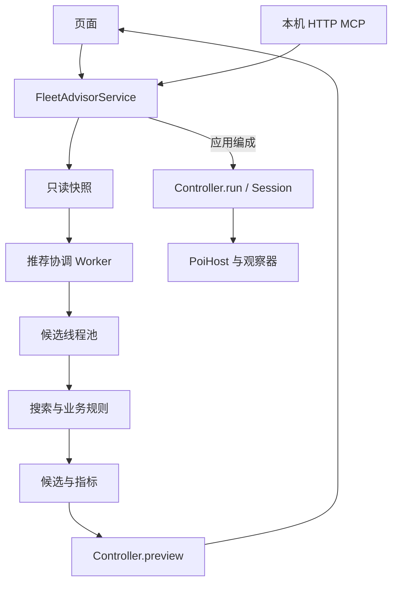

# Fleet Advisor 1.0 架构与维护

舰队参谋是 CommonJS poi 插件。UI、本机 MCP 和推荐 Worker 共用规则与应用服务；游戏操作集中在明确的执行链。React、ReactDOM 和 Electron 由 poi 宿主提供。

## 目录与依赖

```text
index.js                      poi 生命周期与依赖装配
src/
  application/                快照、查询、预览、任务编排
  domain/
    fleet/                    编成计划、装备规则、舰队指标
    combat/                   战斗机制、参考攻击力与标签数据
    routes/                   分岐、路线规划、索敌与制空损耗
    expeditions/              远征条件、收益与配装规则
  recommendation/             候选、流派、评分与搜索
    loadout/                  通用、对地、对潜与夜战配装
  execution/                  游戏操作、会话、请求及最终核对
  host/                       poi 状态、Electron 与资源适配
  vision/                     图片归一化、观察器与识别 Worker
  infrastructure/
    cache/                    推荐、计算与地图资源缓存
    persistence/              编成方案与远征进度存储
    workers/                  推荐协调 Worker 与候选线程池
  config/                     全局筛选与计算资源设置
  shared/                     名称匹配、错误与纯计算上下文
  bridge/                     HTTP、MCP 协议及工具适配
  ui/
    shell/                    页签、设置和执行反馈
    fleet/                    当前舰队只读页
    workbench/                常规图、远征共用编辑工作台
    expedition/               远征专用视图和显示模型
    maps/                     海图资源、绘制、缩放与加载
    settings/                 设置控件与就近反馈
    models/                   共用只读显示模型
    components/               选择器、标签、拖拽和悬停提示
data/                         规则、敌情、模板与必要图像
tests/                        按职责组织的回归测试
tools/                        test.cjs 及分类维护工具
docs/                         架构和英文 MCP 参考
```

| 层 | 职责 | 依赖边界 |
| --- | --- | --- |
| `index.js` | 生命周期、服务和 Worker 装配 | 不放搜索或战斗公式 |
| `application` | 快照、合同、查询、计划与任务 | 统一承接 UI 和 MCP |
| `domain` | 编成、数值及规则判定 | 不访问 UI、HTTP 或游戏操作 |
| `recommendation` | 组合候选、配装、评分和有界搜索 | 不创建宿主或执行游戏操作 |
| `execution` | 进入画面、调整、等待和核对 | 通过注入的会话访问宿主与观察器 |
| `host` / `vision` | 宿主能力与图像观察 | 不决定推荐策略 |
| `infrastructure` | 文件、缓存和线程生命周期 | 不重定义业务规则 |
| `ui` / `bridge` | 显示与输入适配 | 调用应用服务，共用规则 |

`shared/calculation_cache.js` 只提供可注入的纯计算上下文；磁盘 I/O 位于 `infrastructure/`。`config/` 负责默认值和规范化，不依赖界面或账号存储。

## 查询、推荐与执行



当前舰队读取实际舰队或游戏预设；常规海域和远征维护独立草稿。查询、推荐、装备试配和预览不修改游戏。

`domain/fleet/fleet_plan.js` 的 `createFleetPlanner` 生成并验证计划，供推荐器、带路与 `Controller.preview` 复用。`organize_planner.js` 解析编成合法性。`Controller.run` 进入执行链，使用同一计划、实例约束、实时状态核对、执行锁和幂等任务。

请求监测保持被动。取消只停止后续步骤，已发出的游戏请求不能被吞掉、伪造或改写。执行期间保留 UI 布局，只更新进度、计时和停止入口，结束后统一刷新派生信息。

## 推荐模块

公共入口为 `src/recommendation/index.js`。

| 模块 | 内容 |
| --- | --- |
| `context.js` | 可用名册、手动与排除条件、舰娘家族及装备保留 |
| `scoring.js` | 舰体、开幕攻击、空优、昼夜战及特殊攻击评分 |
| `fitting.js` | 制空、提速、索敌与战斗配装候选调整 |
| `strategies.js` | 攻略流派、舰种模板、种子及舰位约束 |
| `normal.js` | 常规候选、批量评估、短名单与最终筛选 |
| `expedition.js` | 成功／大成功目标、候选、配装与净收益比较 |
| `loadout/` | 通用及专门装备策略 |

依赖方向为 `context → scoring → fitting → strategies → normal`，后者使用前者。远征主要复用上下文和远征规则。对潜公式在 `domain/combat/asw_combat.js`，实际试配在 `loadout/asw_fitting.js`，规则不反向依赖搜索。

新增机制先区分数值规则与搜索策略。推荐必须尊重手动舰位和装备；特殊攻击重排仅在许可范围内进行，最终核对路线、索敌、制空及可用性。有界搜索失败不证明玩家库存绝无方案。

月度远征数值模型在 `domain/expeditions/expedition_stats.js`：从观测面板还原本体与蓝字，按候选装备、远征改修和满搭载数投影；未完全确认的飞机贡献使用保守下限。`recommendation/loadout/expedition_stats.js` 在真实库存、适配、运输桶与手动槽位约束内做缺口搜索，局部停滞时有限尝试联合换装。候选船组不能因现有配装未达标就提前丢弃；自动调装与收益配装完成后再次统一核对。该计算缓存只属于当前只读快照，键包含完整槽位。

## 线程与缓存

`infrastructure/workers/recommendation_worker.js` 管理协调线程和远征目标并行；`recommendation_pool.js` 分配常规候选任务。线程间只传快照、任务和结果，在线宿主、控制器及账号存储服务不跨线程。

常规线程可自动选择或指定 1–8，远征使用独立的 1–2 线程设置，实际数量受可用处理器限制。Worker 使用模块 `__filename` 作为入口，共用计算实现。

| 缓存 | 键与复用 | 必须重新执行 |
| --- | --- | --- |
| 完整推荐 | 完整快照、参数、设置和实现指纹 | 输入变化后的搜索 |
| 底层计算 | 依赖明确的纯计算特征 | 实例分配、库存与状态、评分和最终核对 |
| 编成方案 | 临时完整方案，最多 200 条 | 应用前的预览与实时核对 |

三类缓存由 `cache/disk_cache_budget.js` 共用 `cacheLimitMiB`，不分别预留字节配额。完整推荐与底层缓存各保留最多 64 个文件及 7 天保留期。实现指纹覆盖 `src/` 和 `data/`，输入或实现变化使对应结果失效。

方案文件、可识别损坏备份和残留写入文件均计入预算。容量扫描只查文件属性、不递归或跟随链接。主线程串行管理方案写入和推荐协调 Worker 的磁盘变更，候选子线程只读，避免超额并发写入。

`schemeCache=false` 时保存返回 `SCHEME_CACHE_DISABLED`，已有方案可读可删。写入优先回收计算缓存；无法放入或回收失败时返回 `CACHE_CAPACITY_EXCEEDED`，不覆盖原方案。降低上限可能清除无法容纳的方案，主线程同步清空内存。方案不是长期配置。

## 页面与 MCP

`ui/shell/panel.js` 装配页面与服务，工作台共用舰卡、装备选择、草稿及应用入口。地图绘制共用节点、缩放、敌情弹窗；机制标签的排序、图标与渲染集中在 `components/mechanism_badges.js`。

`application/page_queries.js` 复用纯只读显示模型，为 MCP 提供舰队、地图与远征信息，不创建 React 组件或操作会话。换装指标按快照与候选装备差异计算，投影值不伪装成游戏观测值。

| MCP 模块 | 职责 |
| --- | --- |
| `application/fleet_advisor_service.js` | UI 与 MCP 共用服务 |
| `bridge/http_server.js` | 回环监听、Host/Origin、大小限制与总开关 |
| `bridge/mcp_tools.js` | 工具名称、英文描述和 JSON Schema |
| `bridge/tool_validation.js` | 字段、嵌套、互斥来源和范围校验 |
| `bridge/service_api.js` | 工具派发 |
| `bridge/mcp_http.js` | JSON-RPC 协商、工具和合同资源 |

MCP 只需 HTTP 地址，不使用访问令牌；端口冲突明确报错。完整约定见 [MCP API](MCP_API.md)。修改工具后运行 `node tools/dev/generate-mcp-reference.js`，根测试检查文档同步。

## 数据与来源

分岐使用 `data/normal_routes/` 的权威规则，流派使用 `data/normal_route_guides.json`。索敌按路线具体节点的系数判断；地图、敌情与血条分别提供显示和战斗资料，不能替代分岐连接。详细格式见[海域数据](../data/sortie/README.md)。

远征收益与大成功概率依据 Wiki 独立实现。`expedition_income.js` 处理装备加成、补给及分别取整的收益；`expeditions.js` 检查条件并估算概率。`tools/data/import-expedition-wiki.py` 生成结构化奖励和参考表，完整输入留在项目外。

海图通过资源索引按需加载，公共图集随包，开发参考大图放项目外。地图元数据的字节校验规则见[地图资源](../data/sortie/maps/README.md)。所有来源及许可见 [THIRD_PARTY.md](../THIRD_PARTY.md)。

## 工具与交付

| 目录 | 用途 |
| --- | --- |
| `tools/package/` | 发行文件检查及离线独立安装冒烟 |
| `tools/dev/` | 后台热更新、文件准备和回滚 |
| `tools/data/` | 规则、敌情、装备及地图导入 |
| `tools/bench/` | 搜索覆盖、耗时与内存评测 |
| `tools/live/` | poi 现场核验 |
| `tools/vision/` | 模板构造、识别与缩放采样 |

测试与打包命令见[开发与验证](../README.md#开发与验证)。检查现场工具的实际行为和授权后再运行，不能只根据文件名认定为只读。后台热更新保留草稿与游戏状态；依赖、入口或目录变化采用完整安装。

识别素材受 `tests/fixtures/privacy.json` 约束，必须保留隐私检查及识别阈值。账号、凭据、原始网页、缓存、日志、临时产物和历史备份不提交。

交付分别报告源码回归、发行包检查、poi 只读验证和实际操作验收；未执行的项目不能视为通过。未经用户授权不发布 npm 或推送仓库。
